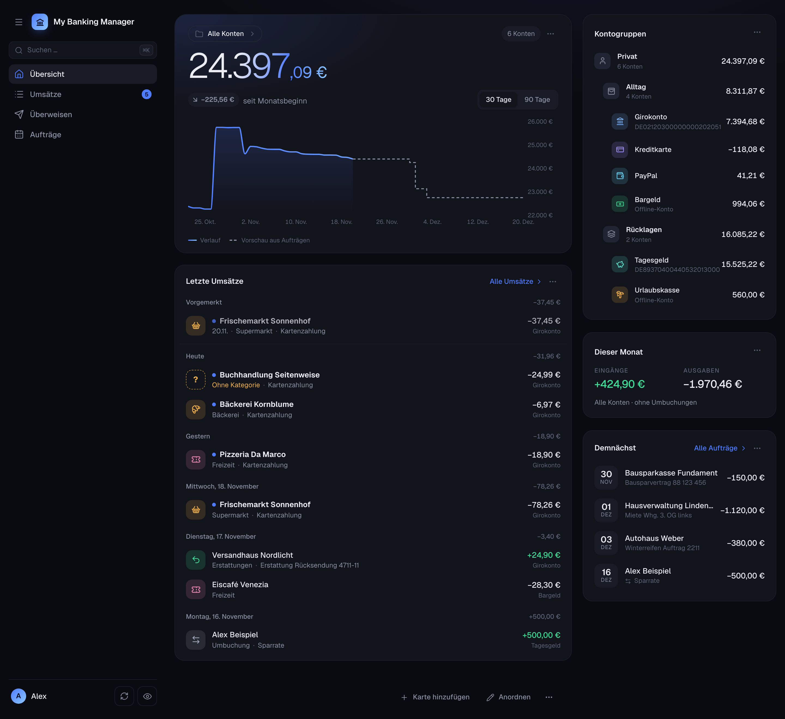

# My Banking Manager (MBM)

[](https://opensource.org/licenses/MIT)
[](https://nodejs.org/) 

**Homebanking, das du selbst betreibst.** My Banking Manager läuft auf deinem eigenen Server, zum
Beispiel zu Hause, und speichert dort alle Daten verschlüsselt. Du öffnest es im Browser, am
Rechner wie am Handy.

**Deine Bankdaten bleiben bei dir.** Viele Finanz-Apps holen Kontostände und Umsätze über einen
fremden Dienstleister ab, der dafür deine Zugangsdaten bekommt, und legen die Daten auf Servern des
Anbieters im Internet ab. MBM macht beides nicht: Es verbindet sich selbst und direkt mit deiner
Bank, und deine Daten verlassen deinen Server nicht.



<sub>Alle Bilder zeigen erfundene Beispieldaten.</sub>

## Funktionen

- **Bankkonten über FinTS** — Kontostände und Umsätze direkt von der Bank, mit eigenem
  FinTS-Konnektor. Getestet mit der Sparkasse und S-pushTAN. Abgerufen wird nur, wenn du es
  auslöst.
- **Offline-Konten** — Bargeld, Sparbuch, Depot und alles ohne Online-Zugang: Buchungen von Hand,
  Saldo abgleichen, Gegenbuchungen.
- **Umsätze** — Konten- und Kategorienbaum, Saldoverlauf, Filter und eine Suche mit Feldern,
  Beträgen, Zeiträumen und `UND`/`ODER`/`NICHT`. Neue Umsätze sind markiert und gezählt.
- **Kategorien und Regeln** — Regeln ordnen neue Umsätze automatisch zu.
- **CSV-Import in jedes Konto** — Vorschau, Erkennung von Doppelten, Rückgängig.
- **Überweisen** — mit Empfängerüberprüfung, Echtzeitüberweisung, Empfängerliste und Verlauf;
  freigegeben in deiner Banking-App.
- **Aufträge** — Dauer- und Terminaufträge ansehen, mit den nächsten Terminen und einer Vorschau
  im Saldoverlauf.
- **Übersicht aus Karten** — jeder Benutzer stellt sie selbst zusammen.
- **Mehrere Benutzer** — jeder mit eigener Anmeldung bei MBM und bei der Bank.
- **Sicher von Anfang an** — vollständig verschlüsselte Datenbank, Passwort und Authenticator-App,
  gesperrt nach jedem Neustart und bei Inaktivität, keine Telemetrie, keine Daten an Dritte.

## Schnellstart

Du brauchst Docker mit Compose und davor einen Reverse Proxy mit HTTPS im Heimnetz.

Lege `compose.yaml` aus diesem Repository in ein leeres Verzeichnis und daneben eine `.env`
(Vorlage `.env.example`) mit dem offiziellen Image:

```bash
MBM_IMAGE_SERVER_FULL=ghcr.io/stefgo/mbm-server-full:latest
```

```bash
docker compose pull && docker compose up -d
```

Der Container `mbm-server-full` enthält Server, Web-Client und FinTS-Konnektor und hört auf Port
`3040`. Dann MBM im Browser öffnen:

1. **Ersten Benutzer** anlegen: Name und Passwort (mindestens 12 Zeichen). Das Passwort
   verschlüsselt die Datenbank.
2. Den **Wiederherstellungsschlüssel** sicher aufbewahren, getrennt vom Backup. Ohne ihn und ohne
   Passwort sind die Daten verloren.
3. Die **Authenticator-App** einrichten.
4. Unter *Einstellungen* mit **Konto hinzufügen** einen Bankzugang (FinTS) oder ein Offline-Konto
   anlegen.

Nach jedem Neustart ist MBM gesperrt, bis sich jemand mit seinem Passwort anmeldet.

**FinTS-Produkt-ID:** Banken verlangen für FinTS eine registrierte Produkt-ID. Die offiziellen
Release-Images von `mbm-server-full` bringen die von MBM mit. Wer MBM selbst baut, verändert oder
Server und Konnektor als zwei Container betreibt (`compose.split.yaml`, Images `mbm-server` und
`mbm-fints`), registriert eine eigene auf fints.org und trägt sie als `MBM_FINTS_PRODUCT_ID` in die
`.env` ein. Die ID im Image steht nicht unter der MIT-Lizenz ([NOTICE](NOTICE)).

Der [Schnellstart in der Dokumentation](https://stefgo.github.io/my-banking-manager/schnellstart/)
erklärt dieselben Schritte mit Bildern, dazu Reverse Proxy und Konfiguration.

## Dokumentation

**[stefgo.github.io/my-banking-manager](https://stefgo.github.io/my-banking-manager/)**, die Quellen
liegen in [`docs/`](./docs):

- [Schnellstart](https://stefgo.github.io/my-banking-manager/schnellstart/) und
  [Konfiguration](https://stefgo.github.io/my-banking-manager/konfiguration/)
- Benutzung: [Übersicht](https://stefgo.github.io/my-banking-manager/guide/uebersicht/),
  [Umsätze und Suche](https://stefgo.github.io/my-banking-manager/guide/umsaetze/),
  [Konten](https://stefgo.github.io/my-banking-manager/guide/konten/),
  [Kategorien und Regeln](https://stefgo.github.io/my-banking-manager/guide/kategorien-regeln/),
  [CSV-Import](https://stefgo.github.io/my-banking-manager/guide/import/),
  [Überweisen](https://stefgo.github.io/my-banking-manager/guide/ueberweisen/),
  [Aufträge](https://stefgo.github.io/my-banking-manager/guide/auftraege/),
  [Einstellungen](https://stefgo.github.io/my-banking-manager/guide/einstellungen/)
- [Sicherheit](https://stefgo.github.io/my-banking-manager/sicherheit/),
  [Updates und Backup](https://stefgo.github.io/my-banking-manager/updates/),
  [Technische Details](https://stefgo.github.io/my-banking-manager/operations/)
- [Entwicklung](https://stefgo.github.io/my-banking-manager/development/)

## Entwicklung

Ein npm-Monorepo: `shared` (Zod-Schemas und die Routenliste der Server-API), `server` (Fastify,
vollständig verschlüsseltes SQLite), `connectors/fints` (eigener FinTS-Konnektor), `clients/web`
(React 19, Vite) und `contracts` (erzeugte OpenAPI-Datei). Node.js 26 oder neuer.

```bash
npm install
npm run dev:server     # Server auf Port 3040
npm run dev:web        # Web-Client auf Port 5173
npm test               # Vitest: shared, server, web
npm run typecheck && npm run lint
npm run screenshots    # Bilder der Dokumentation neu aufnehmen
```

Einrichtung, Aufbau und Veröffentlichung stehen in der
[Entwicklerdokumentation](https://stefgo.github.io/my-banking-manager/development/).

## Lizenz

MIT — siehe [LICENSE](LICENSE). Ausgenommen ist die FinTS-Produkt-ID in den offiziellen Images von
`mbm-server-full`: Sie steht nicht unter der MIT-Lizenz und darf nur mit dem unveränderten
offiziellen Image genutzt werden, siehe [NOTICE](NOTICE).
