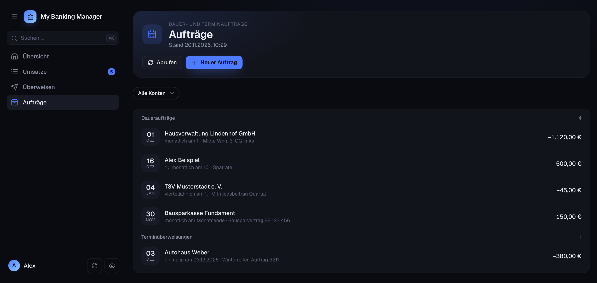
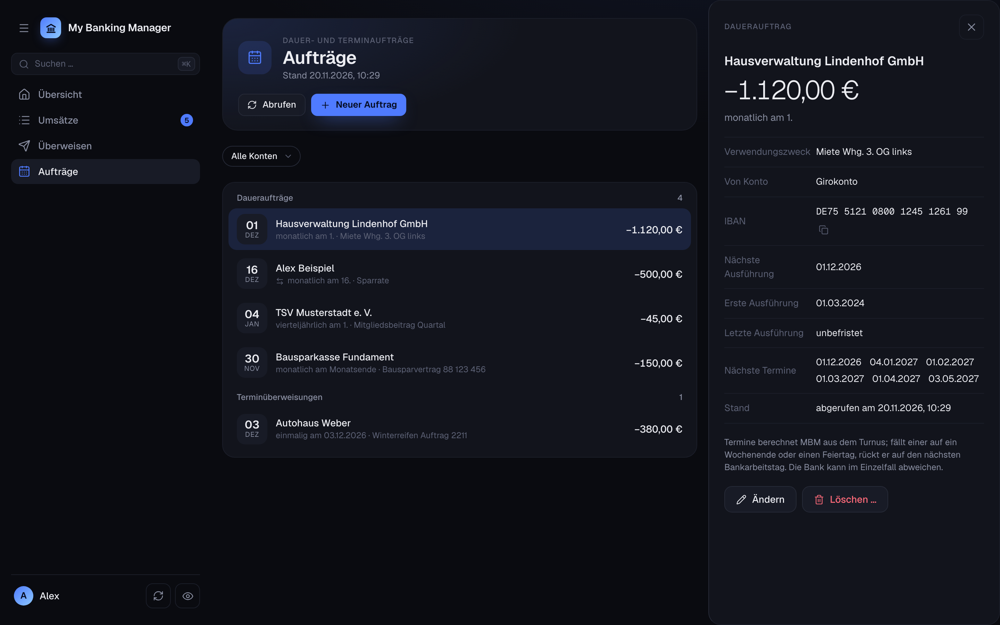
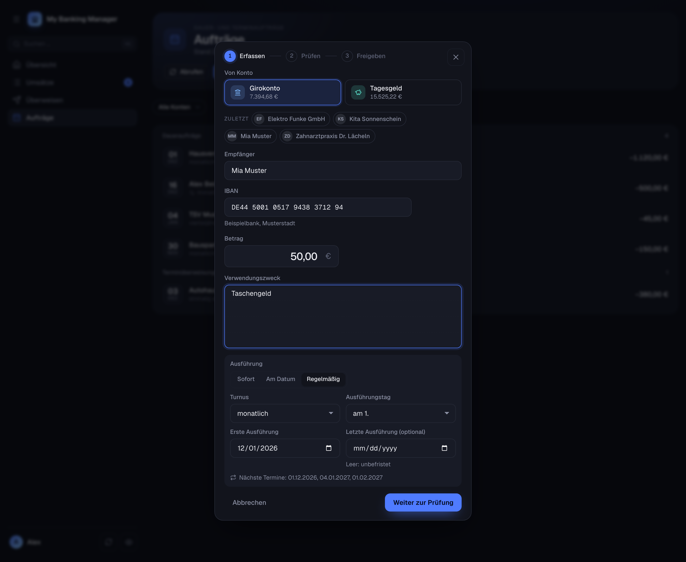

# Aufträge

Unter **Aufträge** stehen die **Daueraufträge** und **Terminüberweisungen** deiner Bankkonten,
so wie die Bank sie beim letzten Abruf gemeldet hat. Du kannst hier neue Aufträge anlegen und
bestehende ändern oder löschen. Die Bank bleibt dabei die Quelle: MBM schickt jede Änderung an die
Bank und ruft danach ihre Liste neu ab.

*Jeder Auftrag mit seinem nächsten Termin, dem Turnus und dem Verwendungszweck. Der Pfeil markiert einen Auftrag an ein eigenes Konto.*

- **Abrufen:** Die Aufträge kommen mit jedem Abruf der Umsätze. Verlangt deine Bank für die
  Auftragsliste jedes Mal eine Freigabe, holt sie nur der Knopf „Abrufen“ auf dieser Seite.
- **Filter:** „Alle Konten“ oder ein einzelnes Konto.
- **Details:** Ein Klick zeigt Empfänger, IBAN, ersten und letzten Termin und die nächsten
  Termine.

*Die nächsten Termine berechnet MBM aus dem Turnus. Fällt einer auf ein Wochenende oder einen Feiertag, rückt er auf den nächsten Bankarbeitstag; die Bank kann im Einzelfall abweichen.*

## Neuer Auftrag

**Neuer Auftrag** öffnet denselben Dialog wie [Überweisen](ueberweisen.md), mit der Ausführung
**Regelmäßig**. Für eine einmalige Zahlung an einem bestimmten Tag wählst du **Am Datum**.

*Turnus und Ausführungstag bietet MBM nur so an, wie deine Bank sie erlaubt. Darunter stehen die nächsten Termine.*

- **Regelmäßig (Dauerauftrag):** Turnus (monatlich, alle 2 Monate, vierteljährlich, halbjährlich,
  jährlich; wöchentlich nur, wenn deine Bank es anbietet), Ausführungstag (1. bis 30. oder
  Monatsende), erste Ausführung und optional die letzte. Ohne letzte Ausführung läuft der Auftrag
  unbefristet.
- **Am Datum (Terminüberweisung):** ein Tag in der Zukunft, so weit voraus, wie deine Bank es
  zulässt (bei vielen Sparkassen bis zu 360 Tage). Fällt er auf ein Wochenende oder einen
  Feiertag, nennt MBM den Bankarbeitstag, an dem die Bank voraussichtlich ausführt.
- **Echtzeitüberweisung** gibt es nur bei „Sofort“.

Dann geht es wie bei einer Überweisung weiter: **Prüfen** mit Empfängerüberprüfung, wo deine Bank
sie verlangt, und **Freigeben** in der Banking-App.

## Ändern

In den Details eines Auftrags öffnet **Ändern** den Dialog mit allen Angaben des Auftrags. Das
Konto bleibt fest. Ändern kannst du nur, was deine Bank erlaubt; was sie sperrt, steht als Text da
(bei Sparkassen etwa der Wechsel zwischen monatlich und wöchentlich). Vor dem Senden zeigt MBM
jedes geänderte Feld mit dem alten und dem neuen Wert.

Die Bank bekommt den vollständigen Auftrag mit den Änderungen. Sie gelten ab der nächsten
Ausführung.

## Löschen

**Löschen …** zeigt den Auftrag noch einmal und fragt nach. Nach „Bei der Bank löschen“ gibst du
den Auftrag in der Banking-App frei. Steht die nächste Ausführung kurz bevor, weist MBM darauf
hin: Die Bank führt sie womöglich noch aus.

!!! info "Wann es nicht geht"
    „Ändern“ und „Löschen“ fehlen, wenn deine Bank es für das Konto nicht über FinTS anbietet,
    den Auftrag ausdrücklich sperrt, ihm keine Auftragsnummer gegeben hat, oder wenn du für das
    Konto keine eigene Bank-Anmeldung hast. Dann geht es nur im Online-Banking.

## Danach

Nach jedem Auftrag ruft MBM die Aufträge des Kontos neu ab, wenn die Bank dafür keine Freigabe
verlangt, sonst bietet das Ergebnis „Aufträge abrufen“ an. Im Verlauf unter
[Überweisen](ueberweisen.md) steht jeder Auftrag mit seiner Art, etwa „Änderung des
Dauerauftrags“.

!!! warning "Ausgang unbekannt"
    Reißt die Verbindung ab, nachdem der Auftrag an die Bank ging, zeigt MBM **„Ausgang
    unbekannt“** und sendet nichts noch einmal. Der neue Abruf klärt es meist: Steht der neue
    Auftrag in der Liste der Bank (oder fehlt der gelöschte), wird daraus „ausgeführt“. Sonst sieh
    bitte im Online-Banking nach, bevor du ihn noch einmal anlegst.

Hat jemand den Auftrag inzwischen anders geändert, etwa im Online-Banking, sendet MBM nichts und
bittet dich, die Aufträge neu abzurufen.

## Vorschau im Saldoverlauf

Aus den Aufträgen rechnet MBM die **Vorschau**: die gestrichelte Linie im Saldoverlauf der
[Übersicht](uebersicht.md) und die Karte „Demnächst“. Ein Auftrag an ein eigenes Konto, etwa die
Sparrate aufs Tagesgeld, senkt den Saldo des einen Kontos und erhöht den des anderen; im Saldo
aller Konten ändert er nichts.
