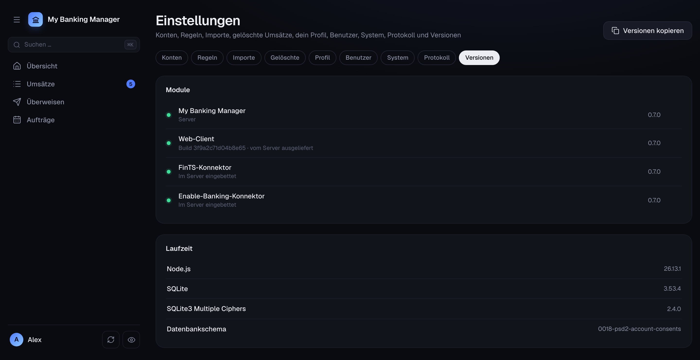

# Einstellungen

Die Einstellungen (++g++ dann ++e++) haben neun Bereiche.

| Bereich | Inhalt |
|---|---|
| **Konten** | Status der Kontoabfrage, Bankzugänge mit den Anmeldungen, Offline-Konten, BLZ-Verzeichnis. Siehe [Konten](konten.md). |
| **Regeln** | Die Regeln für Kategorien. Siehe [Kategorien und Regeln](kategorien-regeln.md#regeln). |
| **Importe** | Importformate anlegen und bearbeiten, alle CSV-Importe mit Rückgängig und **CSV importieren** für einen neuen Import. Siehe [CSV-Import](import.md). |
| **Gelöschte** | Alle gelöschten Umsätze nach Konto, mit **Wiederherstellen** und bei Importen **Endgültig löschen** |
| **Profil** | Was nur dich betrifft: Passwort, Authenticator, deine Geräte, Darstellung |
| **Benutzer** | Was andere betrifft: Benutzer anlegen und entfernen, ihnen beim Zugang helfen, ihre Geräte abmelden |
| **System** | Was alle betrifft: Wiederherstellungsschlüssel, MBM für alle sperren |
| **Protokoll** | Wer wann was getan hat |
| **Versionen** | Versionen aller Module, Zustand der Konnektoren, Laufzeit und Datenbankschema |

## Gelöschte

*Die gelöschten Umsätze, je Konto in der Reihenfolge der Seitenleiste.*

Löschst du einen Umsatz der Bank, eines Imports oder eine Buchung, die MBM für PayPal ergänzt hat,
blendet MBM ihn nur aus (siehe [Buchungen erfassen, ändern und löschen](umsaetze.md#buchungen-erfassen-ändern-und-löschen)). Hier stehen alle diese
Umsätze, gruppiert nach Konto und je Konto der jüngste zuerst, mit Buchungstag, Zeitpunkt des
Löschens und Betrag. Ein Klick auf einen Umsatz öffnet seine Details, **Wiederherstellen** holt ihn
in Liste und Auswertungen zurück. Eine Buchung, die du selbst erfasst hast, ist nach dem Löschen
weg und steht hier nicht.

### Endgültig löschen

Ein gelöschter Umsatz bleibt mit allen Angaben gespeichert, damit ein erneuter Import ihn als
vorhanden erkennt und ein Abruf ihn nicht wiederbringt. Bei einem Umsatz aus einem
[CSV-Import](import.md) entfernt ihn der Papierkorb in seiner Zeile oder **Endgültig löschen** in
seinen Details ganz. Danach lässt er sich nicht mehr wiederherstellen. Importierst du
eine Datei, die ihn enthält, noch einmal, oder liefert ihn die Bank bei einem Abruf, kommt er als
neuer Umsatz wieder. Am Kontostand ändert das nichts, denn ein gelöschter Umsatz zählt schon nicht
mehr.

Umsätze von der Bank und solche, die MBM für PayPal ergänzt hat, lassen sich nicht endgültig
löschen: Der nächste Abruf brächte sie wieder. Bei PayPal-Konten geht es auch für importierte
Umsätze nicht, denn MBM rechnet die ergänzten Buchungen aus allem, was PayPal geliefert hat.

## Profil

*Deine Anmeldung, deine Geräte und die Darstellung, getrennt für Browser und macOS.*

**Passwort ändern** und **Authenticator wechseln** bestätigst du mit deinem Passwort und einem Code
aus der Authenticator-App. Deine Bankzugänge bleiben dabei erhalten, deine anderen Sitzungen werden
beendet. Der bisherige Authenticator gilt, bis du den neuen bestätigt hast.

Hast du dein Telefon nicht zur Hand, wechselst du den Authenticator mit Passwort und
[Wiederherstellungsschlüssel](../sicherheit.md#zugang-wiederherstellen).

Unter **Meine Geräte** stehen deine angemeldeten Browser und Geräte-Tokens. Ein **Geräte-Token**
brauchst du für den künftigen macOS-Client. Es gilt, bis du es abmeldest.

## Benutzer

*Alle Benutzer. Deine eigene Zeile führt in dein Profil.*

Jeder Benutzer kann weitere Benutzer anlegen und entfernen, das Passwort oder den Authenticator
eines anderen zurücksetzen und dessen Geräte abmelden. Du bestätigst das jedes Mal mit dem Code
deiner Authenticator-App oder deinem Passwort. Jedes Passwort öffnet die ganze Datenbank; deshalb
sind mindestens 12 Zeichen Pflicht.

!!! note "Passwort zurückgesetzt"
    Setzt ein anderer Benutzer dein Passwort zurück (oder du mit dem Wiederherstellungsschlüssel),
    gibst du danach Anmeldename und PIN deiner Bank neu ein. Sie waren mit einem Schlüssel aus
    deinem alten Passwort verschlüsselt. Konten und Umsätze bleiben.

## System

*Der Wiederherstellungsschlüssel und die Sperre für alle.*

Es gibt **einen Wiederherstellungsschlüssel für die ganze Installation**. Ein neuer Schlüssel macht
den alten für alle ungültig; du bestätigst ihn mit Passwort und Code. Bewahre ihn wie den ersten
getrennt vom Backup auf. Mehr unter [Sicherheit](../sicherheit.md).

## Protokoll

*Anmeldungen, Entsperren, angelegte Benutzer und Geräte, Importe und mehr, mit Zeit und Benutzer.*

Auch fehlgeschlagene Anmeldungen und Bestätigungen stehen hier.

## Versionen

*Server, Web-Client und Konnektoren mit ihren Versionen, darunter die Laufzeit.*

Unter **Module** stehen der Server, der Web-Client, der FinTS-Konnektor und der
Enable-Banking-Konnektor. Bei jedem Konnektor siehst du, ob er im Server eingebettet ist
(Image `mbm-server-full`) oder als eigener Dienst läuft. Ein gelber Punkt zeigt ein Problem: Der
Konnektor antwortet nicht, oder für den FinTS-Konnektor ist keine
[Produkt-ID](../konfiguration.md#fints-produkt-id) eingetragen. Solange das so ist, ruft MBM bei
dieser Art von Bankzugang nichts ab. Ein grauer Punkt heißt: Der Konnektor ist nicht eingerichtet.

Zeigt dein Browserfenster noch eine ältere Oberfläche, als der Server ausliefert, steht beim
Web-Client **veraltet**. Ein Klick auf den Pfeil daneben lädt die neue Oberfläche.

Unter **Laufzeit** stehen die Versionen von Node.js, SQLite und SQLite3 Multiple Ciphers, das die
Datenbank verschlüsselt, dazu die letzte Migration der Datenbank.

**Versionen kopieren** legt alles als Text in die Zwischenablage, etwa für eine Fehlermeldung. Der
Text enthält nur Versionen, keine Bank- oder Personendaten.
