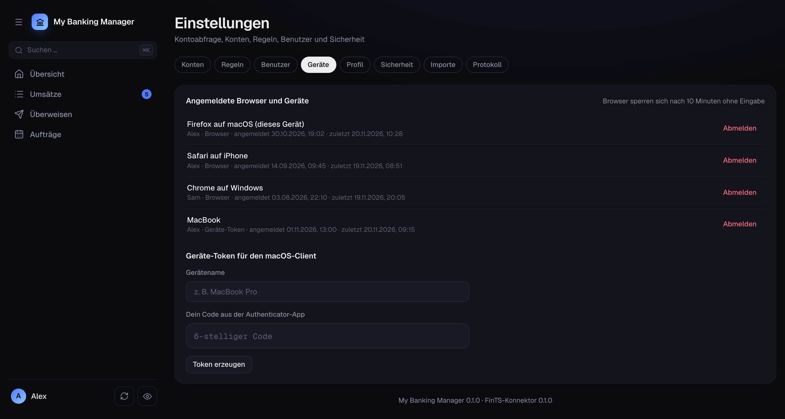
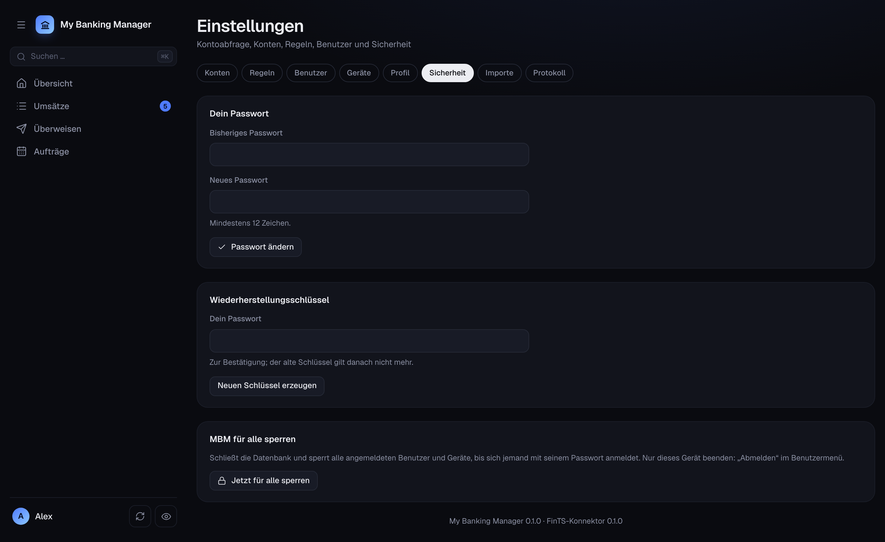

# Einstellungen

Die Einstellungen (++g++ dann ++e++) haben acht Bereiche. Unten auf jeder Seite stehen die
Versionen von MBM und vom FinTS-Konnektor.

| Bereich | Inhalt |
|---|---|
| **Konten** | Status der Kontoabfrage, Bankzugänge mit den Anmeldungen, Offline-Konten, BLZ-Verzeichnis. Siehe [Konten](konten.md). |
| **Regeln** | Die Regeln für Kategorien. Siehe [Kategorien und Regeln](kategorien-regeln.md#regeln). |
| **Benutzer** | Alle Benutzer von MBM |
| **Geräte** | Angemeldete Browser und Geräte-Tokens |
| **Profil** | Darstellung und „Beträge beim Start ausblenden“, je Geräteklasse |
| **Sicherheit** | Eigenes Passwort, Wiederherstellungsschlüssel, Sperren |
| **Importe** | Importformate anlegen und bearbeiten, alle CSV-Importe mit Rückgängig und **CSV importieren** für einen neuen Import. Siehe [CSV-Import](import.md). |
| **Protokoll** | Wer wann was getan hat |

## Benutzer

*Jeder Benutzer hat ein eigenes Passwort und eine eigene Authenticator-App.*

Jeder Benutzer kann weitere Benutzer anlegen, Passwörter neu setzen, den Authenticator eines
Benutzers zurücksetzen und Benutzer entfernen. Folgenreiche Schritte bestätigst du jedes Mal mit
dem Code deiner Authenticator-App oder deinem Passwort. Jedes Passwort öffnet die ganze
Datenbank; deshalb sind mindestens 12 Zeichen Pflicht.

!!! note "Passwort neu gesetzt"
    Setzt ein anderer Benutzer dein Passwort neu (oder du mit dem Wiederherstellungsschlüssel),
    gibst du danach Anmeldename und PIN deiner Bank neu ein. Sie waren mit einem Schlüssel aus
    deinem alten Passwort verschlüsselt. Konten und Umsätze bleiben.

## Geräte

*Angemeldete Browser und Geräte-Tokens aller Benutzer; jedes lässt sich abmelden.*

Ein **Geräte-Token** brauchst du für den künftigen macOS-Client. Es gilt, bis du es abmeldest.

## Profil

*Darstellung (hell, dunkel, wie System) und „Beträge beim Start ausblenden“, getrennt für Browser und macOS.*

## Sicherheit

*Passwort ändern, einen neuen Wiederherstellungsschlüssel erzeugen und MBM für alle sperren.*

Ein **neuer Wiederherstellungsschlüssel** macht den alten ungültig. Bewahre ihn wie den ersten
getrennt vom Backup auf. Mehr unter [Sicherheit](../sicherheit.md).

## Protokoll

*Anmeldungen, Entsperren, angelegte Benutzer und Geräte, Importe und mehr, mit Zeit und Benutzer.*

Auch fehlgeschlagene Anmeldungen und Bestätigungen stehen hier.
