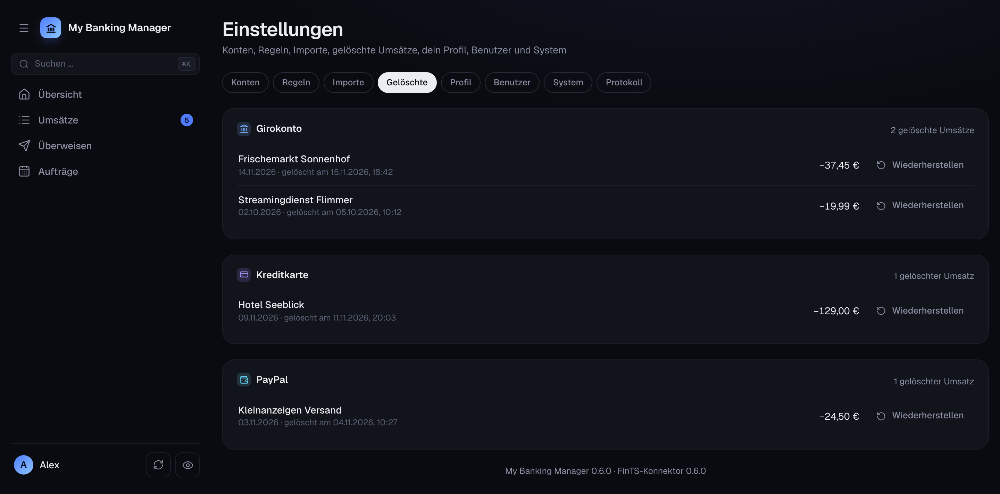
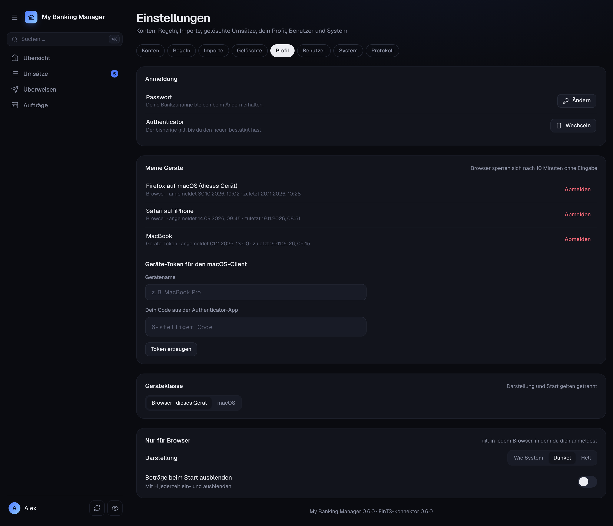
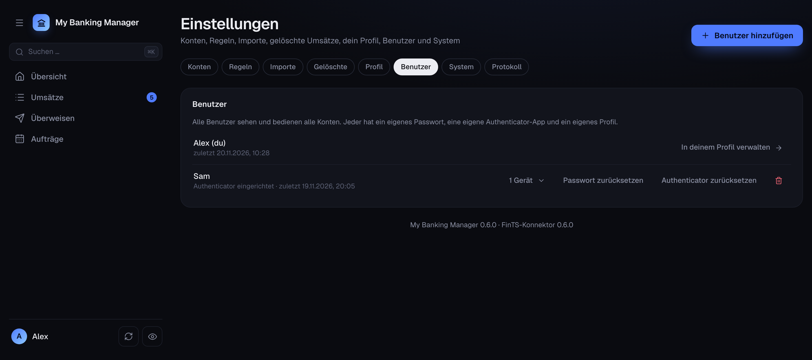
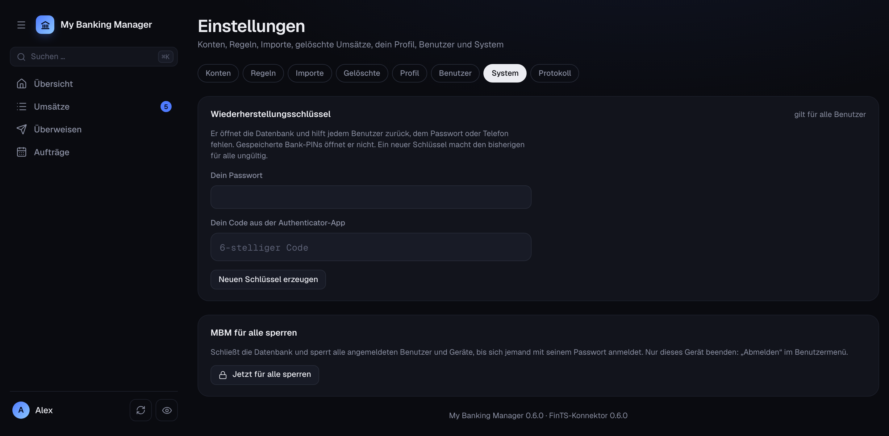
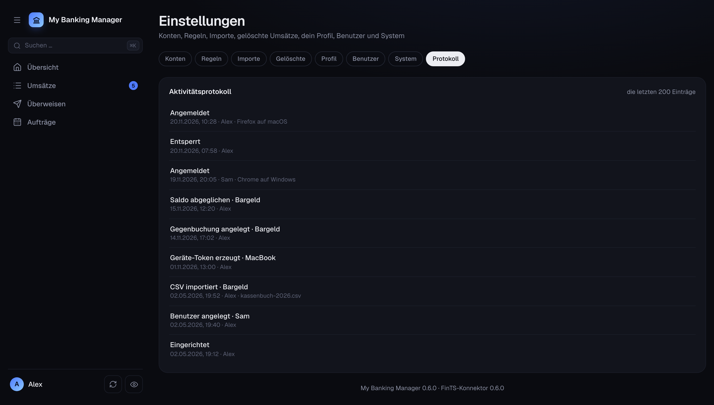

# Einstellungen

Die Einstellungen (++g++ dann ++e++) haben acht Bereiche. Unten auf jeder Seite stehen die
Versionen von MBM und vom FinTS-Konnektor.

| Bereich | Inhalt |
|---|---|
| **Konten** | Status der Kontoabfrage, Bankzugänge mit den Anmeldungen, Offline-Konten, BLZ-Verzeichnis. Siehe [Konten](konten.md). |
| **Regeln** | Die Regeln für Kategorien. Siehe [Kategorien und Regeln](kategorien-regeln.md#regeln). |
| **Importe** | Importformate anlegen und bearbeiten, alle CSV-Importe mit Rückgängig und **CSV importieren** für einen neuen Import. Siehe [CSV-Import](import.md). |
| **Gelöschte** | Alle gelöschten Umsätze nach Konto, mit **Wiederherstellen** |
| **Profil** | Was nur dich betrifft: Passwort, Authenticator, deine Geräte, Darstellung |
| **Benutzer** | Was andere betrifft: Benutzer anlegen und entfernen, ihnen beim Zugang helfen, ihre Geräte abmelden |
| **System** | Was alle betrifft: Wiederherstellungsschlüssel, MBM für alle sperren |
| **Protokoll** | Wer wann was getan hat |

## Gelöschte

*Die gelöschten Umsätze, je Konto in der Reihenfolge der Seitenleiste.*

Löschst du einen Umsatz der Bank, eines Imports oder eine Buchung, die MBM für PayPal ergänzt hat,
blendet MBM ihn nur aus (siehe [Buchungen erfassen, ändern und löschen](umsaetze.md#buchungen-erfassen-ändern-und-löschen)). Hier stehen alle diese
Umsätze, gruppiert nach Konto und je Konto der jüngste zuerst, mit Buchungstag, Zeitpunkt des
Löschens und Betrag. Ein Klick auf einen Umsatz öffnet seine Details, **Wiederherstellen** holt ihn
in Liste und Auswertungen zurück. Eine Buchung, die du selbst erfasst hast, ist nach dem Löschen
weg und steht hier nicht.

## Profil

*Deine Anmeldung, deine Geräte und die Darstellung, getrennt für Browser und macOS.*

**Passwort ändern** und **Authenticator wechseln** bestätigst du mit deinem Passwort und einem Code
aus der Authenticator-App. Deine Bankzugänge bleiben dabei erhalten, deine anderen Sitzungen werden
beendet. Der bisherige Authenticator gilt, bis du den neuen bestätigt hast.

Hast du dein Telefon nicht zur Hand, wechselst du den Authenticator mit Passwort und
[Wiederherstellungsschlüssel](../sicherheit.md#zugang-wiederherstellen).

Unter **Meine Geräte** stehen deine angemeldeten Browser und Geräte-Tokens. Ein **Geräte-Token**
brauchst du für den künftigen macOS-Client. Es gilt, bis du es abmeldest.

## Benutzer

*Alle Benutzer. Deine eigene Zeile führt in dein Profil.*

Jeder Benutzer kann weitere Benutzer anlegen und entfernen, das Passwort oder den Authenticator
eines anderen zurücksetzen und dessen Geräte abmelden. Du bestätigst das jedes Mal mit dem Code
deiner Authenticator-App oder deinem Passwort. Jedes Passwort öffnet die ganze Datenbank; deshalb
sind mindestens 12 Zeichen Pflicht.

!!! note "Passwort zurückgesetzt"
    Setzt ein anderer Benutzer dein Passwort zurück (oder du mit dem Wiederherstellungsschlüssel),
    gibst du danach Anmeldename und PIN deiner Bank neu ein. Sie waren mit einem Schlüssel aus
    deinem alten Passwort verschlüsselt. Konten und Umsätze bleiben.

## System

*Der Wiederherstellungsschlüssel und die Sperre für alle.*

Es gibt **einen Wiederherstellungsschlüssel für die ganze Installation**. Ein neuer Schlüssel macht
den alten für alle ungültig; du bestätigst ihn mit Passwort und Code. Bewahre ihn wie den ersten
getrennt vom Backup auf. Mehr unter [Sicherheit](../sicherheit.md).

## Protokoll

*Anmeldungen, Entsperren, angelegte Benutzer und Geräte, Importe und mehr, mit Zeit und Benutzer.*

Auch fehlgeschlagene Anmeldungen und Bestätigungen stehen hier.
