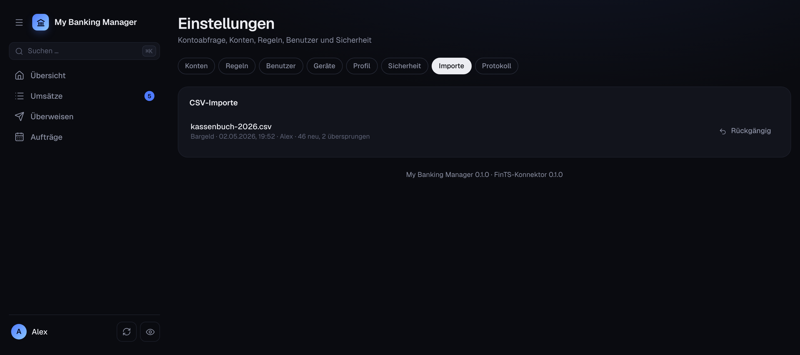

# CSV-Import

In **jedes Konto** lassen sich Umsätze aus einer CSV-Datei übernehmen: ältere Umsätze aus dem
Online-Banking, den Export eines anderen Finanzprogramms oder ein Kassenbuch für ein
Offline-Konto.

## So geht es

1. Unter **Einstellungen → Importe** auf **CSV importieren** klicken (dann wählst du das Konto im
   Dialog) oder in der Befehlspalette ++cmd+k++ nach „Importieren“ suchen. Bei einem Offline-Konto
   geht es auch über **Importieren …** in seinem Menü.
2. Die Datei in den Dialog ziehen oder auswählen. MBM liest UTF-8 und Windows-1252 und Dateien bis
   20 MB.
3. **Spalten prüfen:** MBM erkennt die Spalten gängiger Exporte (zum Beispiel Sparkasse CSV-CAMT,
   DKB, ING, PayPal und verbreiteter Finanzprogramme) selbst. Passt eine Zuordnung nicht, änderst
   du sie in der Vorschau.
4. **Vorschau ansehen:** Jede Zeile ist *neu*, *doppelt* oder *ungültig* (mit Grund). Nur neue
   Zeilen werden übernommen; bei doppelten kannst du die Kategorie aus der Datei übernehmen
   ([abweichende Kategorien](#abweichende-kategorien)).
5. **Importieren.**

## Doppelte Umsätze

Ein Umsatz gilt als schon vorhanden, wenn Buchungsdatum, Betrag und IBAN der Gegenseite gleich
sind. Ohne IBAN vergleicht MBM den Namen der Gegenseite, ohne Groß- und Kleinschreibung, Akzente,
Leer- und Satzzeichen. Der Verwendungszweck zählt nicht, weil Exporte ihn oft unterschiedlich
aufbereiten. So kannst du dieselbe Datei auch zweimal importieren, ohne etwas doppelt zu haben.

## Umsatzart

Hat die Datei eine Spalte wie `Buchungstext`, `Umsatzart` oder `Vorgang`, übernimmt MBM sie als
Umsatzart (etwa „Lastschrift“). Eine andere Spalte ordnest du in der Vorschau unter **Umsatzart**
zu.

Fehlt einem vorhandenen Umsatz die Umsatzart, ergänzt MBM sie aus der Datei; die Vorschau zeigt
dann „Umsatzart wird ergänzt“. So kannst du sie auch für schon importierte Umsätze nachtragen,
indem du die Datei noch einmal importierst. Eine vorhandene Umsatzart bleibt immer erhalten.

## Kategorien

Hat die Datei eine Kategorie-Spalte (etwa `Wohnen\Miete`), übernimmt MBM sie. Fehlende Kategorien
legt es auf Wunsch an. Zeilen ohne Kategorie laufen durch die [Regeln](kategorien-regeln.md#regeln).

### Abweichende Kategorien

Nennt die Datei bei einem Umsatz, den es schon gibt, eine andere Kategorie, zeigt die Vorschau
„Kategorie abweichend“ und darunter `bisher: … → Datei: …`. Unten im Dialog wählst du
**Kategorie bei … vorhandenen Umsätzen überschreiben**; dann bekommen diese Umsätze die Kategorie
aus der Datei, als hättest du sie von Hand vergeben. Regeln ändern sie danach nicht mehr.

- Fehlt die Kategorie der Datei noch, wird sie nur übernommen, wenn du auch **Fehlende Kategorien
  anlegen** wählst.
- Aufgeteilte Buchungen bleiben, wie sie sind („aufgeteilt, bleibt“).
- Zeilen ohne Kategorie in der Datei ändern nichts.

## Rückgängig machen

Unter **Einstellungen → Importe** steht jeder Import mit Datei, Zeitpunkt, Benutzer und Anzahl;
über **CSV importieren** startest du dort auch einen neuen.
„Rückgängig“ löscht die Umsätze dieses Imports, die noch da sind. Kategorien und Umsatzarten, die
der Import bei vorhandenen Umsätzen geändert oder ergänzt hat, bleiben erhalten.

*Einstellungen → Importe: jeder Import lässt sich rückgängig machen.*

Importierte Umsätze sind für die anderen Benutzer [neu](umsaetze.md#neue-umsätze), für den
Importierenden nicht.
