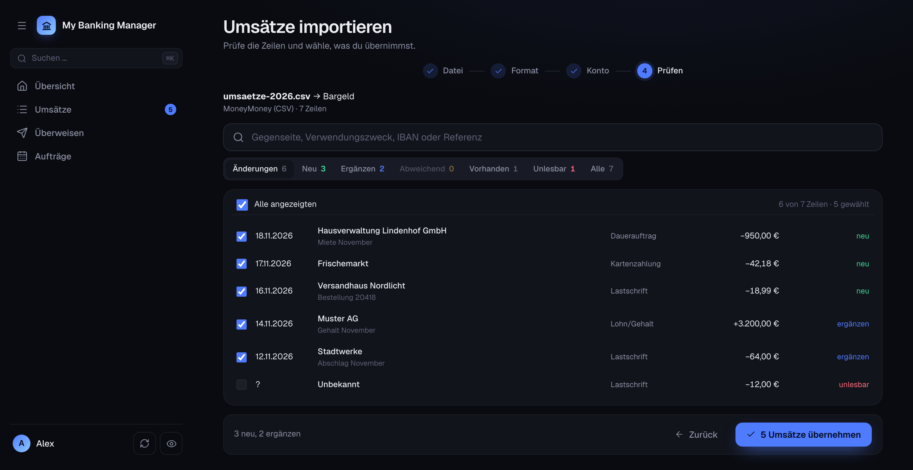
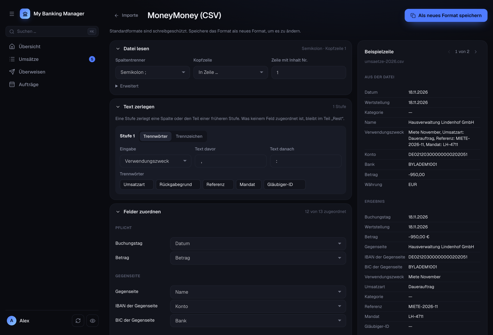

# CSV-Import

In **jedes Konto** lassen sich Umsätze aus einer CSV-Datei übernehmen: ältere Umsätze aus dem
Online-Banking, den Export eines anderen Finanzprogramms oder ein Kassenbuch für ein
Offline-Konto.

## So geht es

Unter **Einstellungen → Importe** klickst du auf **CSV importieren**. Alternativ suchst du in der
Befehlspalette ++cmd+k++ nach „Importieren“ oder wählst bei einem Offline-Konto **Importieren …** in
seinem Menü. Der Import läuft dann auf einer eigenen Seite in vier Schritten:

1. **Datei:** Die Datei hineinziehen oder auswählen. MBM liest UTF-8 und Windows-1252 und Dateien
   bis 20 MB.
2. **Format:** MBM wählt anhand der Kopfzeile ein passendes [Importformat](#importformate) vor. Du
   bestätigst es, wählst ein anderes oder ordnest die Spalten selbst zu. Nur wenn kein Format passt,
   weist MBM dich darauf hin.
3. **Konto:** Das Konto, in das importiert wird. Startest du den Import bei einem Konto, ist es
   schon gewählt.
4. **Prüfen:** Die Filterleiste zeigt, wie viele Zeilen *neu*, zu *ergänzen*, *abweichend*, schon
   *vorhanden* oder *unlesbar* sind. Die Suche findet Gegenseite, Verwendungszweck, IBAN und
   Referenz. Nach dem Buchungsdatum suchst du wie in der Umsatzliste mit `datum` und `>`, `>=`, `<`,
   `<=`, `=` oder `:`, etwa `datum>=1.3.2026 datum<1.4.2026`, `datum:3.2026` oder `datum:vormonat`.
   Ein Klick auf eine Zeile zeigt ihre Details. Anfangs siehst du nur die Zeilen, die etwas ändern
   oder unlesbar sind.

Mit den Kästchen wählst du, was du übernimmst. Anfangs sind alle neuen Umsätze und Ergänzungen
gewählt. Eine [abweichende Kategorie](#abweichende-kategorien) ist nicht gewählt und bleibt, bis du
sie selbst wählst. Eine abgewählte Zeile ändert nichts: kein neuer Umsatz, keine Ergänzung und keine
neue Kategorie. Mit **Umsätze übernehmen** schließt du den Import ab.

Mit **Zurück** oder einem Klick auf einen erledigten Schritt gehst du zurück. Deine Auswahl bleibt
erhalten, solange Datei, Format und Konto gleich bleiben.



*Der Schritt „Prüfen“: filtern, suchen und Zeilen auswählen.*

## Doppelte Umsätze

Ein Umsatz gilt als schon vorhanden, wenn Buchungsdatum, Betrag und IBAN der Gegenseite gleich
sind. Fehlt die IBAN auf einer Seite, haben aber beide eine **Kontonummer** der Gegenseite, gibt diese
den Ausschlag; führende Nullen zählen nicht. So nennen Banken etwa ihr internes Konto bei
Darlehenszinsen. Sonst vergleicht MBM den Namen der Gegenseite, ohne Groß- und Kleinschreibung, Akzente,
Leer- und Satzzeichen. Fehlt auch der Name, muss der Verwendungszweck aus der Datei im
Verwendungszweck des Umsatzes in MBM enthalten sein, nach denselben Vergleichsregeln. Sind beide
Verwendungszwecke leer, gilt das als gleich. So kannst du dieselbe Datei auch zweimal importieren,
ohne etwas doppelt zu haben.

## Saldo bei Bankkonten

Bei einem Bankkonto bleibt der heutige Saldo beim Import und beim Rückgängigmachen auf dem letzten
Stand der Bank. Ältere Umsätze ändern nur den Saldoverlauf davor. Ein zusätzlicher Abruf ist nicht
nötig. Fehlen in der Historie Umsätze, weichen die Tage vor dieser Lücke um die fehlenden Beträge ab.

Liefert die Bank später einen Umsatz, der schon aus einer Datei da ist, legt MBM ihn nicht noch
einmal an. Der vorhandene Umsatz bekommt die Angaben der Bank und behält seine Kategorie. Er gilt ab
dann als Umsatz der Bank, „Import rückgängig“ entfernt ihn also nicht mehr.

**Vorgemerkte Zeilen** übernimmt MBM bei Bankkonten nicht, weil die Bank sie selbst liefert. Sie
stehen im Schritt „Prüfen“ unter **Nicht übernehmbar**.

## Importformate

Ein Format beschreibt, wie MBM eine Datei liest und welcher Wert in welches Feld kommt. Mitgeliefert
sind die **Standardformate** „MoneyMoney (CSV)“ und „Sparkasse CSV-CAMT“. Sie lassen sich nicht
ändern, du kannst sie aber als neues Format speichern. Passen mehrere Formate zur Kopfzeile einer
Datei, haben deine eigenen Vorrang.

Formate bearbeitest du an zwei Stellen mit demselben Editor:

- **Einstellungen → Importe:** Hier legst du Formate an, bearbeitest, kopierst und löschst sie, auch
  ohne Datei. Die Spalten trägst du dann unter **Datei lesen** von Hand ein. Mit einer
  **Beispieldatei** siehst du sofort das Ergebnis. Sie bleibt im Browser und wird nicht gespeichert.
- **Beim Import:** Im Schritt „Format“ passt du das Format für diese Datei an. Die Änderung gilt für
  diesen Import, bis du sie speicherst.

Der Editor hat drei Bereiche, die zu Beginn alle aufgeklappt sind:

- **Datei lesen:** Spaltentrenner (auch aus mehreren Zeichen) und Kopfzeile. Unter **Erweitert**
  stehen Kodierung, Anführungszeichen, Datumsform, Dezimalzeichen, der Trenner von Kategoriepfaden
  und die Wörter für „vorgemerkt“.
- **Text zerlegen:** Bis zu fünf Stufen, die aufeinander aufbauen. Eine Stufe liest eine Spalte oder
  einen Teil einer früheren Stufe.
- **Felder zuordnen:** Welche Spalte oder welcher Teil einer Stufe in welches Feld kommt. Auf
  schmalen Bildschirmen steht der Wert aus der Beispielzeile direkt daneben. Unter
  **Zahlungsdetails** stellst du für jede zugeordnete Referenz ein, wo MBM sie bei vorhandenen
  Umsätzen sucht (siehe [Referenzen](#referenzen)).

Daneben zeigt die **Beispielzeile**, was das Format aus einer Zeile der Datei macht. Unter **Aus der
Datei** stehen alle Spalten mit ihren unveränderten Werten, unter **Ergebnis** das, was MBM daraus
importiert. Mit den Pfeilen blätterst du durch die Datei.



*Der Format-Editor: links die Einrichtung, rechts das Ergebnis für eine Zeile.*

### Stufen

Eine Stufe zerlegt einen Wert auf eine von zwei Arten:

- **Trennzeichen:** Der Wert wird an einem festen Text geteilt, etwa ` // `. Die Teile benennst du
  der Reihe nach.
- **Trennwörter:** MBM sucht feste Wörter mit einem Text davor und danach. Der Wert eines Worts
  reicht bis zum nächsten Trennwort. Kommt ein Wort mehrfach vor, zählt das letzte.

Ein Beispiel mit dem Text davor `, ` und danach `: ` und den Trennwörtern `Umsatzart` und `Referenz`:

```text
Miete Oktober, Umsatzart: Dauerauftrag, Referenz: 12345
```

| Teil | Wert |
|---|---|
| Umsatzart | `Dauerauftrag` |
| Referenz | `12345` |
| Rest | `Miete Oktober` |

Der **Rest** enthält alles, was keinem Feld zugeordnet ist, also auch ein Trennwort ohne Feld. So geht
keine Angabe verloren. Trenner sind immer fester Text, reguläre Ausdrücke gibt es nicht.

## Umsatzart und weitere Angaben

Neben Datum, Betrag und Gegenseite übernimmt MBM die **Umsatzart** (etwa „Lastschrift“), die drei
[Referenzen](#referenzen), das **Mandat**, die **Gläubiger-ID** und die **BIC**. Sie stehen danach in
den [Details des Umsatzes](umsaetze.md#details-eines-umsatzes).

Das Feld **IBAN oder Kontonummer der Gegenseite** liest MBM wie beim Abruf von der Bank: Sieht der
Wert wie eine IBAN aus, ist er die IBAN, sonst die Kontonummer. Ebenso ist das Feld **BIC oder BLZ der
Gegenseite** eine BIC, wenn es mit sechs Buchstaben beginnt, und eine BLZ, wenn es aus acht Ziffern
besteht. Eine BLZ übernimmt MBM nur zusammen mit einer Kontonummer. Bei MoneyMoney stehen beide
Angaben in den Spalten „Konto“ und „Bank“.

Fehlt einem vorhandenen Umsatz eine dieser Angaben, ergänzt MBM sie aus der Datei; die Prüfung zeigt
dann „ergänzen“, und die Details der Zeile stellen für jede dieser Angaben den leeren Wert in MBM
neben den aus der Datei. So kannst du sie auch für schon importierte Umsätze nachtragen, indem
du die Datei noch einmal importierst. Vorhandene Angaben und der Verwendungszweck bleiben dabei
erhalten. Kontonummer und BLZ ergänzt MBM nur bei Umsätzen ohne IBAN.

!!! warning "Regeln und gekürzter Verwendungszweck"
    Das Format „MoneyMoney (CSV)“ speichert als Verwendungszweck nur den freien Text. Eine Regel, die
    dort nach `Umsatzart: Lastschrift` sucht, greift bei neu importierten Umsätzen deshalb nicht mehr.
    Suche stattdessen mit `umsatzart:lastschrift` im eigenen Feld.

### Referenzen

Ein Umsatz hat in MBM drei Referenzen: die **End-to-End-Referenz**, die **Kundenreferenz** und die
**Bankreferenz** (was sie bedeuten, steht bei den
[Details eines Umsatzes](umsaetze.md#details-eines-umsatzes)). Unter **Felder zuordnen →
Zahlungsdetails** ordnest du jeder davon eine eigene Spalte oder einen Teil der Datei zu. Ein neuer
Umsatz bekommt jeden Wert in die Referenz, der du ihn zugeordnet hast. Zwei Referenzen können nicht
dieselbe Quelle lesen, sonst stünde der Wert doppelt da. `NOTPROVIDED` gilt wie beim Abruf als leer.

Viele Dateien mischen die Arten in einer Spalte: Bei MoneyMoney steht hinter `Referenz:` mal die
End-to-End-Referenz, mal die Kundenreferenz, mal die Bankreferenz. Deshalb stellst du unter jeder
zugeordneten Referenz ein, wo MBM bei einem **vorhandenen Umsatz** nachsieht, ob der Wert schon da ist:
**Nicht ergänzen, wenn schon in** End-to-End-Referenz, Kundenreferenz, Bankreferenz.
Anfangs sind alle drei angehakt, die eigene Referenz lässt sich nicht abwählen.

- Steht der Wert schon in einer angehakten Referenz, ergänzt MBM nichts. Groß- und Kleinschreibung
  zählen dabei nicht.
- Sonst ergänzt MBM ihn in der zugeordneten Referenz, wenn sie leer ist.
- Steht dort schon ein anderer Wert, bleibt er.

Ein Beispiel: Ein abgerufener Umsatz hat die Bankreferenz `0815`, aber keine End-to-End-Referenz. Die
Datei nennt `Referenz: 0815`, zugeordnet der End-to-End-Referenz. Mit angehakter Bankreferenz erkennt
MBM den Wert und ergänzt nichts. Ohne das Häkchen stünde `0815` danach auch als End-to-End-Referenz da.

Eine Referenz aus einer Datei verknüpft nie eine Überweisung und bestätigt sie auch nicht. Das
geschieht nur über den Abruf von der Bank.

## Kategorien

Hat die Datei eine Kategorie-Spalte (etwa `Wohnen\Miete`), übernimmt MBM sie. Fehlende Kategorien
legt es an, wenn du über der Liste **Fehlende Kategorien anlegen** wählst. Neue Zeilen ohne Kategorie
laufen durch die [Regeln](kategorien-regeln.md#regeln).

Hat ein vorhandener Umsatz noch **keine Kategorie**, zeigt die Prüfung „ergänzen“, und MBM trägt die
Kategorie aus der Datei ein. Wenn du das nicht möchtest, wählst du die Zeile ab.

### Abweichende Kategorien

Nennt die Datei bei einem Umsatz, den es schon gibt, eine **andere Kategorie**, zeigt die Prüfung
„Kategorie abweichend“. Solche Zeilen stehen im Filter **Abweichend** und sind anfangs nicht gewählt,
deine Kategorie bleibt also erhalten.

Die Details einer Zeile stellen die Kategorie aktuell in MBM und die aus der Datei nebeneinander. Um
sie zu ersetzen, wählst du die Zeile. Für alle angezeigten Zeilen wählst du im Filter **Abweichend**
oben **Alle angezeigten ersetzen**. In den anderen Filtern ändert „Alle angezeigten“ nie eine
vorhandene Kategorie.

Ersetzte Kategorien gelten, als hättest du sie von Hand vergeben. Die Zusammenfassung unten nennt,
wie viele Kategorien der Import ersetzt.

!!! warning "Nicht rückgängig zu machen"
    Auch wenn du den Import später rückgängig machst, bleibt eine ersetzte Kategorie bestehen.

- Hat eine Zeile eine abweichende Kategorie und zugleich leere Angaben, zeigt ihr Kästchen „teilweise“.
  In den Details entscheidest du getrennt über **Kategorie ersetzen** und **Angaben ergänzen**.
- Fehlt die Kategorie der Datei noch, wird sie nur übernommen, wenn du auch **Fehlende Kategorien
  anlegen** wählst.
- Aufgeteilte Buchungen bleiben, wie sie sind („aufgeteilt, bleibt“).
- Zeilen ohne Kategorie in der Datei ändern nichts.

## Rückgängig machen

Unter **Einstellungen → Importe** steht jeder Import mit Datei, Zeitpunkt, Benutzer und Anzahl;
über **CSV importieren** startest du dort auch einen neuen.
„Rückgängig“ löscht die Umsätze dieses Imports, die noch da sind. Kategorien und Angaben, die der
Import bei vorhandenen Umsätzen geändert oder ergänzt hat, bleiben erhalten.

Ist von einem Import nichts mehr da, steht statt „Rückgängig“ **Entfernen**. Es nimmt den Eintrag
aus der Liste. Hast du Umsätze des Imports [gelöscht](umsaetze.md#buchungen-erfassen-ändern-und-löschen),
löschen „Rückgängig“ und „Entfernen“ sie endgültig mit und fragen vorher nach. Importierst du die
Datei danach noch einmal, kommen diese Umsätze wieder.


*Einstellungen → Importe: jeder Import lässt sich rückgängig machen.*

Importierte Umsätze sind für die anderen Benutzer [neu](umsaetze.md#neue-umsätze), für den
Importierenden nicht.
