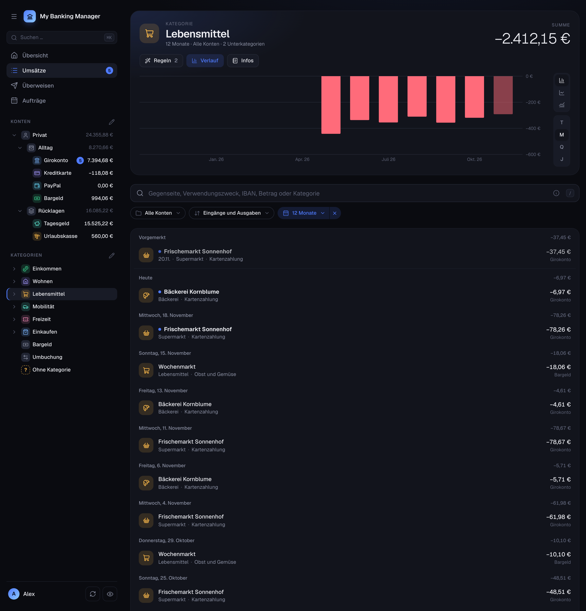
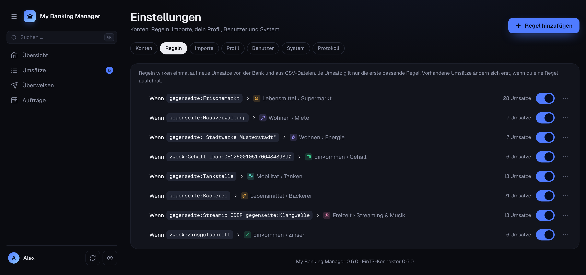

# Kategorien und Regeln

Jeder Umsatz kann eine **Kategorie** haben. Kategorien bilden einen Baum, etwa
„Lebensmittel › Supermarkt“. Eine neue Installation startet mit einem Vorschlag, den du frei
änderst.

## Kategorien

Ein Klick auf eine Kategorie im Kategorienbaum zeigt ihre Umsätze mit der Summe, samt
Unterkategorien. **Verlauf** im Kopf blendet die Summe je Tag, Monat, Quartal oder Jahr als
Diagramm ein (siehe [Verlauf](umsaetze.md#verlauf)).

*Die Kategorie „Lebensmittel“ mit ihren Unterkategorien Supermarkt und Bäckerei, über alle Konten; darüber die Summe je Monat der letzten zwölf Monate.*

- **Anlegen, umbenennen, verschieben:** über das Stift-Symbol über dem Baum oder das Menü einer
  Kategorie. Auch „Ohne Kategorie“ lässt sich an einen anderen Platz im Baum ziehen.
- **Symbol und Farbe:** Eine Unterkategorie ohne eigene Farbe nimmt die ihrer Oberkategorie.
- **Nicht in Auswertungen:** Eine Kategorie wie „Umbuchung“ zählt nicht zu Eingängen und
  Ausgaben. So zählt Geld, das du zwischen eigenen Konten verschiebst, nicht als Ausgabe.
- **Löschen:** Die Umsätze wandern in eine andere Kategorie oder werden „Ohne Kategorie“.

## Regeln

Eine **Regel** besteht aus einer [Suche](umsaetze.md#suche) und einer oder mehreren Aktionen: Sie
setzt eine Kategorie, ändert die angezeigte Gegenseite oder den angezeigten Verwendungszweck. Die
Daten der Bank bleiben dabei unverändert.

Je Umsatz wirkt **genau eine Regel: die erste passende aktive**. Neue Umsätze von der Bank und aus
CSV-Dateien durchlaufen die Regeln einmal, wenn sie ankommen, und bekommen nur Werte für leere Felder.
Buchungen von Hand durchlaufen sie nie von selbst.

*Einstellungen → Regeln: jede Regel mit ihrer Suche, ihren Aktionen und wie viele Umsätze sie trifft.*

- **Anlegen:** „Regel hinzufügen“ oben rechts, Suche eingeben, Aktionen wählen, „Speichern“. Schneller geht es in den
  Details eines Umsatzes: Setzt du dort eine Kategorie, bietet MBM an, sie für alle Umsätze
  dieser Gegenseite zu merken. „Daraus eine Regel machen“ füllt das Formular mit den Werten des Umsatzes.
- **Gilt für:** alle Konten oder einzelne Konten. Die Wahl bleibt auch nach dem Umbenennen oder
  Verschieben eines Kontos gültig. Ist das letzte gewählte Konto gelöscht, zeigt die Regel „Konto
  fehlt“ und trifft nichts mehr.
- **Reihenfolge:** Die erste passende Regel gewinnt. Ziehe genauere Regeln nach oben. Die Liste zeigt
  je Regel ihre Treffer und wie viele davon eine Regel weiter oben erfasst.
- **Ändern:** Im Menü „…“ auf „Bearbeiten“, dann „Speichern“. Das ändert nur die Regel. Mit
  „Speichern & ausführen“ wendest du sie direkt danach auf vorhandene Umsätze an.
- **Aus- und einschalten** mit dem Schalter, ohne die Regel zu löschen.
- **Menü „…“:** In jeder Zeile stehen dort alle Aktionen der Regel: bearbeiten, in den Umsätzen
  zeigen, ausführen, verschieben und löschen.

In Regeln gibt es kein `kategorie:`, kein `ist:neu` und keine relativen Daten wie `-30t`, denn Regeln
lesen nur die Werte der Bank.

### Ausschnitte aus Texten

Eine Regel kann Teile aus den Texten der Buchung herauslösen und in ihren Aktionen einsetzen. Bis zu
fünf Stufen bauen aufeinander auf. Eine Stufe nutzt ein **Muster**, **Trennzeichen** oder
**Trennwörter**, die beiden letzten wie im [CSV-Import](import.md).

| Teil des Musters | Bedeutung |
|---|---|
| fester Text | muss vorkommen; Groß- und Kleinschreibung, Akzente und die Zahl der Leerzeichen sind egal |
| `{name}` | Text bis zum nächsten festen Text oder bis zum Ende |
| `{name:wort}` | Text bis zum nächsten Leerzeichen |
| `{name:zahl}` | zusammenhängende Ziffern |
| `*` | Text überspringen |
| `\*`, `\{`, `\}` | das Zeichen selbst |

Aus `VISA Debit REWE MARKT//MUENCHEN/DE` macht das Muster `VISA Debit {haendler}//{ort}/` die
Ausschnitte „REWE MARKT“ und „MUENCHEN“. Als Gegenseite ergibt `{haendler:titel}` dann „Rewe Markt“.

In Aktionen setzt `{name}` den Ausschnitt ein, `{name:titel}`, `{name:gross}` und `{name:klein}` ändern
die Schreibweise. `{gegenseite}`, `{zweck}` und `{umsatzart}` stehen immer bereit. **Fehlt ein
Ausschnitt, den eine Aktion braucht, trifft die Regel nicht**, und die nächste wird geprüft. Die Probe
im Formular zeigt das an echten Umsätzen, ohne etwas zu speichern.

### Regeln ausführen

Eine neue oder geänderte Regel ändert **keinen vorhandenen Umsatz von selbst**. Starte eine aktive
Regel über „Regel ausführen“ in ihrem Menü „…“. Sie ändert nur Umsätze, bei denen sie die erste passende ist.
Die folgende Seite zeigt, was die Regel tut und wie viele Umsätze sie trifft. Unter „Regel“ kannst du
stattdessen „Alle aktiven Regeln“ wählen und festlegen, welche Werte sich ändern dürfen:

- **Nur leere Felder füllen** lässt vorhandene Werte unverändert.
- **Alles neu berechnen** aktualisiert auch frühere Ergebnisse von Regeln. Beim Lauf über alle aktiven
  Regeln setzt es Anpassungen zurück, die nicht mehr greifen. Kategorien entfernt es nie.

Der Schritt **Änderungen prüfen** zeigt jede Änderung mit Vorher und Nachher. Erst „Übernehmen“ schreibt die
gewählten Änderungen. Gibt es nichts zu ändern oder ist nichts gewählt, beendest du den Lauf ohne
Änderung. Werte von Hand, aus CSV-Dateien oder Gegenbuchungen und alle Buchungen von Hand
sind anfangs abgewählt. Ersetzte Werte lassen sich nicht wiederherstellen. Hat sich seit der Prüfung
etwas geändert, speichert MBM nichts und zeigt den neuen Stand.

Die Regeln eines Kategorie-Knotens erreichst du auch über „Regeln“ im Kopf der Kategorie
(++g++ dann ++r++ führt direkt zur Liste).
