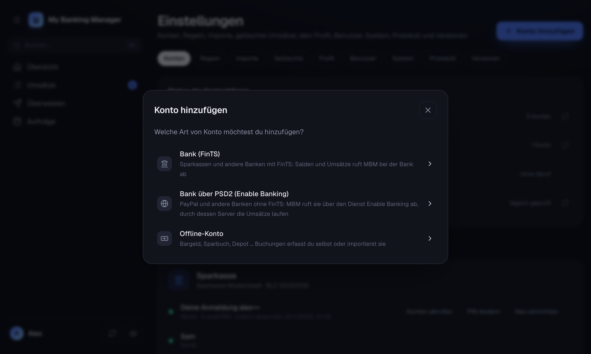
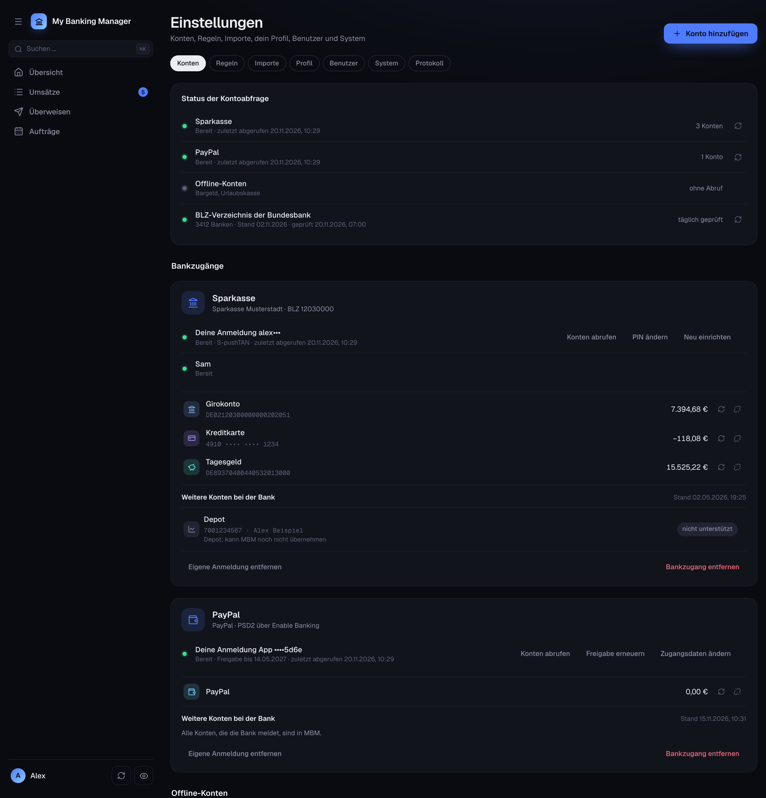
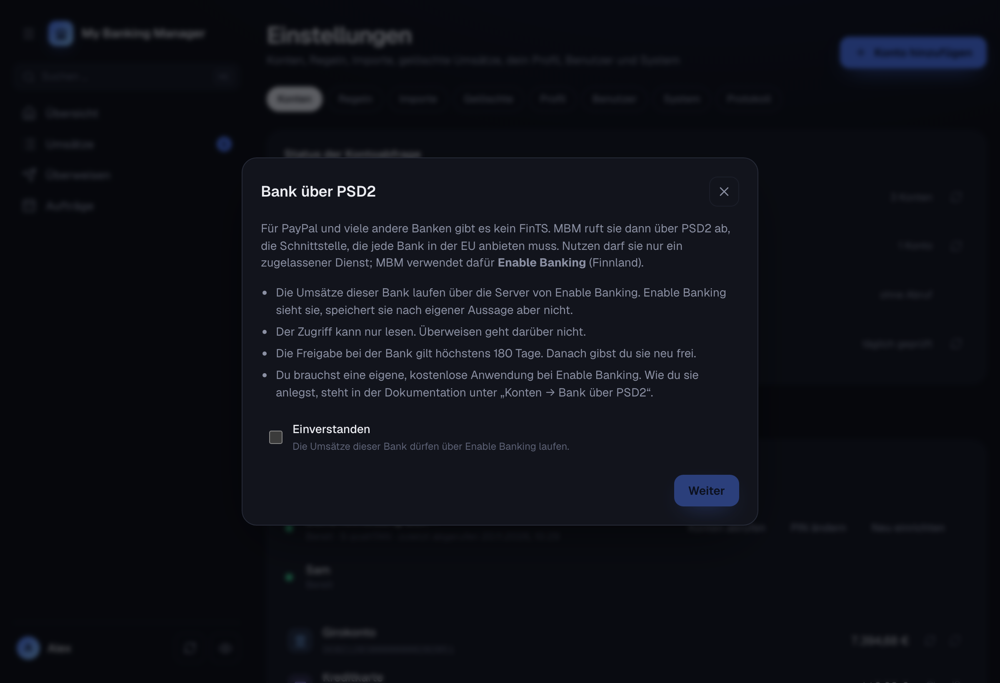
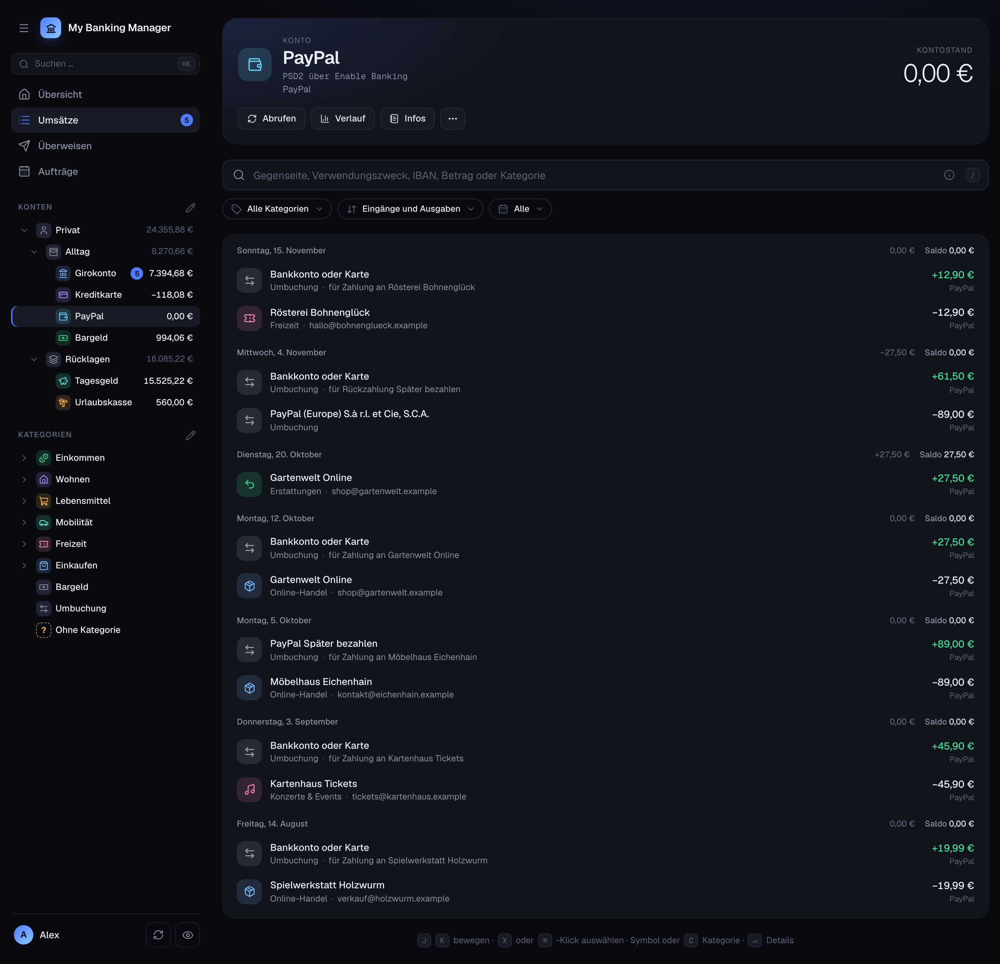
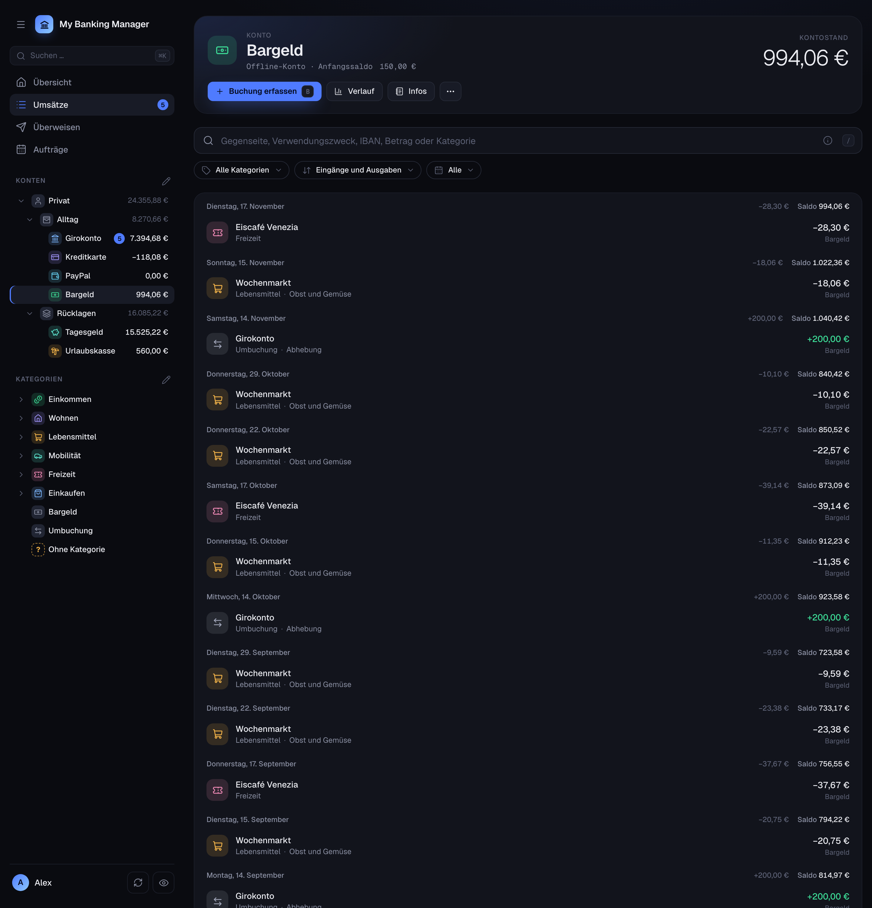

# Konten

MBM kennt zwei Arten von Konten: **Bankkonten**, deren Umsätze MBM über FinTS von der Bank holt,
und **Offline-Konten**, die du selbst führst. Beide legst du unter
**Einstellungen → Konto hinzufügen** an.

*Konto hinzufügen: ein Bankzugang über FinTS oder ein Offline-Konto.*

## Bankzugang einrichten

Für Banken mit FinTS, etwa Sparkassen und Volksbanken: „Konto hinzufügen → Bank (FinTS)“. PayPal
und andere Banken ohne FinTS richtest du [über PSD2](#bank-über-psd2) ein.

1. **Bank** suchen, nach Name, BLZ oder BIC; das Verzeichnis der Bundesbank kennt alle
   deutschen Banken. Dazu die **FinTS-Adresse**: Sie steht im Online-Banking deiner Bank, meist
   unter „Online-Banking-Software“ oder „HBCI/FinTS“, und beginnt mit `https://`.
2. **Anmeldename und PIN** deines Online-Bankings. „PIN speichern“ kannst du abwählen; dann fragt
   MBM bei jedem Abruf nach der PIN und speichert sie nirgends.
3. **TAN-Verfahren** wählen. Damit gibst du Abrufe und Überweisungen frei. MBM zeigt die Verfahren,
   die deine Bank dir anbietet, und empfiehlt eines mit Freigabe in der App, etwa S-pushTAN.
   Manche Verfahren gehören zu einem bestimmten Gerät, etwa deinem Handy mit der App: Dann holt
   „Geräte abrufen“ die Namen bei der Bank, und du wählst deins. Beim Abruf der Konten fragt die
   Bank meist nach einer Freigabe.
4. MBM holt die **Liste deiner Konten**. Du wählst, welche es übernimmt und in welche Gruppe.

Danach stehen die Konten im Kontenbaum. Konten, die MBM noch nicht übernehmen kann (etwa ein
Depot), stehen unter „Weitere Konten bei der Bank“.

*Einstellungen → Konten: Status der Kontoabfrage, der Bankzugang mit den Anmeldungen der Benutzer und seinen Konten, darunter die Offline-Konten.*

### Mehrere Benutzer an einer Bank

Bank, BLZ und FinTS-Adresse gehören allen Benutzern. **Anmeldename und PIN hinterlegt jeder
Benutzer selbst**; sie sind mit einem Schlüssel verschlüsselt, den nur seine eigene Anmeldung an
MBM öffnet. Wer gemeinsame Konten hat, sieht sie einmal, egal wer sie abgerufen hat.

## Bank über PSD2

PayPal und viele andere Banken bieten kein FinTS an. Jede Bank in der EU muss aber eine
Schnittstelle für Kontoinformationen anbieten (PSD2). Nutzen darf sie nur ein zugelassener Dienst;
MBM verwendet dafür **Enable Banking** (Enable Banking Oy, Finnland, unter Aufsicht der finnischen
Finanzaufsicht).

!!! warning "Die Umsätze laufen über Enable Banking"
    Bei einem PSD2-Zugang gehen Saldo und Umsätze dieser Bank durch die Server von Enable Banking.
    Enable Banking sieht sie und speichert nach eigener Aussage nur, was der Zugang technisch
    braucht. Das ist die einzige Ausnahme von „keine Daten über Dritte“ (siehe
    [Sicherheit](../sicherheit.md#keine-daten-über-dritte)). Banken mit FinTS betrifft das nicht.

### Enable Banking vorbereiten

Einmalig, für alle Banken zusammen:

1. Auf enablebanking.com ein Konto anlegen und das **Control Panel** öffnen.
2. Eine **Anwendung** anlegen, Umgebung **Production**. Den privaten Schlüssel lässt du **im
   Browser erzeugen**. Die `.pem`-Datei (benannt nach der Application-ID) lädt der Browser herunter;
   sie verlässt deinen Rechner nicht. Bewahr sie gut auf, Enable Banking hat keine Kopie.
3. Als **Redirect-URL** trägst du eine oder beide Adressen ein, die MBM beim Einrichten anzeigt:
    - `https://<deine-mbm-adresse>/bank-callback`: Die Bank schickt dich nach der Freigabe direkt
      zu MBM zurück.
    - `https://localhost/bank-callback`: Nach der Freigabe lädt die Seite nicht, und du kopierst
      ihre Adresse in MBM. Das geht auch, wenn MBM von außen nicht erreichbar ist.
4. Die weiteren Pflichtangaben der Anwendung (Beschreibung, Datenschutz) füllst du mit deinen
   eigenen Angaben. Die Anwendung nutzt nur du.
5. **Activate by linking accounts:** Du verknüpfst die Anwendung mit deinem eigenen Konto, etwa
   PayPal. Danach läuft sie im kostenlosen **Restricted Mode**: Sie sieht nur Konten, die du so
   verknüpft hast. Für eine weitere Bank verknüpfst du dort zuerst deren Konto.

### In MBM einrichten

*Bevor es losgeht, erklärt MBM, was über Enable Banking läuft.*

1. **Konto hinzufügen → Bank über PSD2 (Enable Banking)**. MBM erklärt, was über Enable Banking
   läuft; weiter geht es erst mit deinem Einverständnis.
2. **Application-ID** eintragen und die **`.pem`-Datei** wählen (oder ihren Inhalt einfügen). MBM
   prüft beides sofort bei Enable Banking. Hast du schon einen PSD2-Zugang, nimmst du dessen
   Anwendung („Wie bei PayPal“); eine reicht für alle Banken.
3. **Land und Bank** wählen. Die Liste kommt von Enable Banking; „Beta“ heißt, Enable Banking
   bietet die Bank noch nicht lange an.
4. **Bei der Bank freigeben:** MBM öffnet die Freigabeseite. Du meldest dich bei der Bank an und
   bestätigst den Zugriff. Mit „Zurück zu MBM“ landest du danach wieder in MBM; mit „Adresse von
   Hand einfügen“ kopierst du die Adresse der Seite, die nicht lädt, in das Feld in MBM. Die
   Freigabe muss innerhalb von 15 Minuten abgeschlossen sein.
5. MBM holt die **Liste deiner Konten**, und du übernimmst sie wie bei FinTS.

Application-ID und Schlüssel speichert MBM verschlüsselt wie eine PIN. Jeder Benutzer richtet seine
eigene Anwendung und Freigabe ein.

### Freigabe erneuern

Eine Freigabe gilt höchstens so lange, wie die Bank erlaubt, bei PayPal **180 Tage**. Unter
Einstellungen → Konten steht beim Bankzugang „Freigabe bis …“. Zwei Wochen vor dem Ende weist MBM
darauf hin. Ist die Freigabe abgelaufen oder hast du sie bei der Bank widerrufen, steht dort
„Freigabe bei der Bank nötig“. **Freigabe erneuern** (beim Bankzugang oder im Abruf) wiederholt nur
Schritt 4; Konten und Umsätze bleiben.

Entfernst du deine Anmeldung oder den Bankzugang, beendet MBM die Freigabe auch bei Enable Banking.
Bei der Bank (etwa unter PayPal → Einstellungen → Datenschutz) kannst du sie jederzeit selbst
widerrufen.

### Was PayPal liefert

- **Saldo** in Euro und alle Umsätze. Der erste Abruf reicht so weit zurück, wie die Bank erlaubt,
  bei PayPal zwei Jahre.
- **Keinen Verwendungszweck.** MBM schreibt stattdessen die E-Mail-Adresse der Gegenseite dorthin,
  damit du danach suchen kannst. Die PayPal-Transaktionsnummer steht in den Details als
  Bankreferenz.
- Als **Umsatzart** „Zahlung“, „Erstattung“, „Rückzahlung Später bezahlen“ oder „Auszahlung auf
  Bankkonto“. Abgelehnte und stornierte Zahlungen übernimmt MBM nicht.
- **Nur Euro.** Umsätze in einer anderen Währung übernimmt MBM nicht und sagt beim Abruf, wie viele
  es waren.
- **Nicht, woher das Geld kam.** PayPal meldet die Zahlung an den Händler, aber nicht die Abbuchung
  von deinem Bankkonto oder deiner Karte. MBM ergänzt sie (siehe unten).

### Abbuchungen, die MBM ergänzt

Zahlst du mit PayPal, ohne genug Guthaben zu haben, holt PayPal den Rest von einer deiner
Zahlungsquellen. Diese Buchung fehlt in dem, was PayPal über PSD2 schickt. Ohne sie zeigte das
PayPal-Konto nur Ausgaben, und der Saldoverlauf stimmte nicht. MBM rechnet sie deshalb aus dem
Saldo nach:

- **Guthaben zuerst:** Eine Zahlung nimmt, was an Guthaben da ist. Für den Rest steht beim selben
  Datum eine **Abbuchung** von „Bankkonto oder Karte“. Welche deiner Zahlungsquellen PayPal genutzt
  hat, meldet PayPal nicht.
- **Später bezahlen:** Ein Kauf mit „Später bezahlen“ bekommt statt der Abbuchung eine Buchung
  **Später bezahlen**. Die Abbuchung steht dann bei der **Rückzahlung** etwa 30 Tage später, denn
  erst dann holt PayPal das Geld. Erkennen kann MBM das erst mit der Rückzahlung: Bis dahin steht
  beim Kauf eine Abbuchung, danach die Buchung „Später bezahlen“. Gibt es im Monat davor zwei Käufe
  mit dem Betrag der Rückzahlung (etwa ein Abo), bleibt es bei der Abbuchung.
- **Auszahlungen** aufs Bankkonto bekommen nie eine Abbuchung.
- Ergänzte Buchungen stehen als normale Zeilen in der Liste, sind nie neu und lassen sich nicht
  löschen. In den Details steht „von MBM ergänzt“ und der Link zur Zahlung, bei der Zahlung der Link
  zu ihrer Abbuchung.

Geht die Rechnung nicht auf, etwa weil du trotz Guthaben das Bankkonto gewählt hast, ergänzt MBM
nur, was „Guthaben zuerst“ ergibt. Den Rest fängt der Anfangssaldo des Kontos auf. Der Saldo stimmt
immer mit dem von PayPal überein.

### Was bei PayPal nicht zählt

Diese Buchungen sind weder Einnahme noch Ausgabe. MBM gibt ihnen automatisch die Kategorie, die du
als **Vorbelegung für Gegenbuchungen** gewählt hast (anfangs „Umbuchung“, zählt nicht in
Auswertungen). Regeln vergeben ihnen keine andere:

- die ergänzten Abbuchungen und „Später bezahlen“
- die **Rückzahlung Später bezahlen**: Gezählt wird der Kauf, am Tag des Kaufs
- die **Auszahlung auf Bankkonto**
- eine **Erstattung zu abgelehnter Zahlung**: PayPal hat die Zahlung als abgelehnt oder storniert
  gemeldet, und MBM hat sie nicht übernommen. Die Erstattung über denselben Betrag von derselben
  Gegenseite zählt dann auch nicht.

Wählst du für eine dieser Buchungen von Hand eine andere Kategorie, zählt sie wieder. Ohne
Vorbelegung für Gegenbuchungen bleiben sie ohne Kategorie und zählen.

!!! note "Nach dem Update"

    Beim ersten Abruf nach dem Update holt MBM die PayPal-Umsätze einmal so weit zurück, wie PayPal
    erlaubt. Schon gespeicherte Umsätze bleiben dabei, wie sie sind, und kommen nicht doppelt.
    Rückzahlungen, Auszahlungen und Erstattungen zu abgelehnten Zahlungen bekommen ihre neue
    Umsatzart und die Vorbelegung. Eine Kategorie, die du selbst gewählt hast, bleibt.

## Abrufen

MBM ruft **nur ab, wenn du es auslöst**: im Kopf eines Kontos, einer Gruppe oder mit dem Knopf
unten links für alle Konten. Verlangt die Bank eine Freigabe, zeigt MBM ihren Text, und du gibst
den Abruf in der Banking-App frei. Neue Umsätze bekommen ihre Kategorie über die
[Regeln](kategorien-regeln.md) und sind als [neu](umsaetze.md#neue-umsätze) markiert. Zusammen mit
den Umsätzen holt MBM auch die [Aufträge](auftraege.md).

Der erste Abruf eines Kontos holt alle Umsätze, die die Bank herausgibt. Danach beginnt jeder Abruf
**zwei Wochen vor dem letzten Abruf dieses Kontos**, so kommen auch Buchungen an, die die Bank
verspätet bucht. Nach einer Pause holt MBM die ganze Zeit seither nach. Für Zeiträume über rund
90 Tage verlangen die meisten Banken eine Freigabe, etwa beim ersten Abruf oder nach einer langen
Pause; ein Konto mit seltenen Buchungen löst sie sonst nicht aus.

Bei einem PSD2-Zugang gibt es keine TAN: Die Freigabe bei der Bank deckt jeden Abruf ab, bis sie
endet. MBM nennt der Bank dabei die IP-Adresse und den Browser, von dem aus du den Abruf
startest. So zählt die Bank ihn als von dir ausgelöst; ohne diese Angabe erlauben PSD2-Banken nur
vier Abrufe am Tag.

Solange ein Abruf läuft, dreht sich in der Kontenliste ein Symbol neben jedem Konto, das gerade
aktualisiert wird. Liegt das Konto in einer zugeklappten Gruppe, steht das Symbol an der Gruppe.

## Offline-Konten

Für Bargeld, Sparbuch, Depot und alles ohne Online-Zugang. Ein Offline-Konto hat einen Namen, eine
Gruppe und einen **Anfangssaldo**: den Kontostand vor der ersten Buchung.

*Ein Offline-Konto: Buchungen erfasst du selbst, importierst sie oder legst sie als Gegenbuchung an.*

- **Buchung erfassen** (++b++ oder im Menü des Kontos): Datum, Betrag, Gegenseite, Zweck,
  Kategorie. Regeln wirken auf Buchungen von Hand nur, wenn du sie beim
  [Ausführen](kategorien-regeln.md#regeln-ausführen) auswählst.
- **Saldo abgleichen:** Du gibst den gezählten Bestand ein, MBM bucht die Differenz.
- **Gegenbuchung:** In den Details eines Umsatzes, etwa einer Abhebung am Geldautomaten, legt
  „Gegenbuchung in Offline-Konto“ denselben Betrag mit umgekehrtem Vorzeichen im Offline-Konto
  an. Beide Buchungen stehen dann unter „Umbuchung“ und zählen nicht als Einnahme oder Ausgabe.
- **Importieren:** siehe [CSV-Import](import.md).

## Konten ordnen

Im Kontenbaum ordnest du Konten in **Gruppen** und Untergruppen, unabhängig von der Bank. Das
Stift-Symbol über dem Baum schaltet in den Bearbeitungsmodus; dort ziehst du Konten und Gruppen
an ihren Platz. Das Menü eines Kontos (Rechtsklick, am Handy langes Drücken) bietet unter anderem
Umbenennen, Symbol und Farbe, Infos, Verschieben und Löschen.

**Infos** sind eigene Merkmale und Notizen zu einem Konto, einer Gruppe oder Kategorie, etwa
Kontoinhaber oder Ansprechpartner.

**Vom Bankzugang lösen** (unter **Einstellungen → Konten**, Symbol in der Zeile des Kontos) macht
aus einem Bankkonto ein Offline-Konto mit allen Buchungen oder löscht es; die Bank meldet es dann
nicht mehr als neu.
