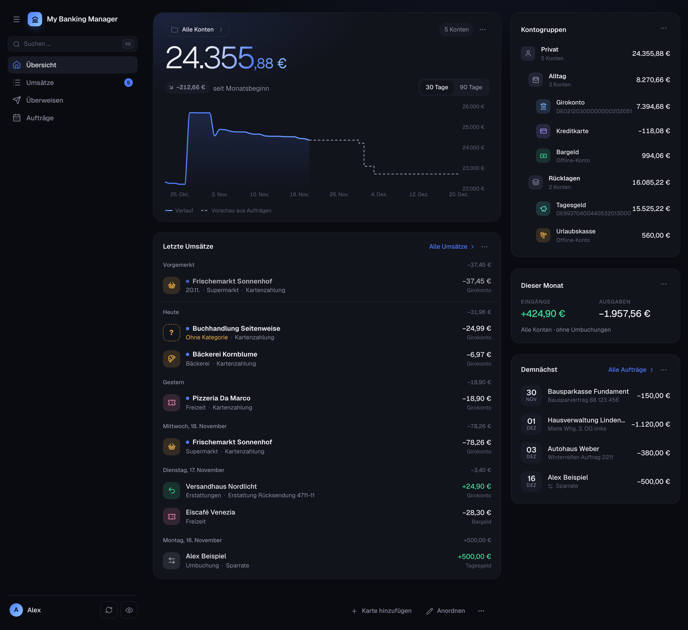
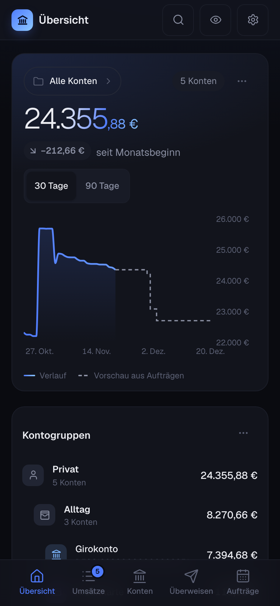

# Übersicht

Die Übersicht ist die Startseite von MBM. Sie besteht aus **Karten**, die jeder Benutzer für sich
zusammenstellt.

*Die Übersicht eines neuen Benutzers: Saldo mit Verlauf, Kontogruppen, letzte Umsätze, „Dieser Monat“ und „Demnächst“.*

## Die Karten

| Karte | Zeigt |
|---|---|
| **Saldo mit Verlauf** | Saldo eines Kontos, einer Gruppe oder aller Konten, die Änderung seit Monatsbeginn und den Verlauf über 30 oder 90 Tage. Die gestrichelte Linie ist die Vorschau aus den Dauer- und Terminaufträgen. |
| **Kontogruppen** | Den Kontenbaum mit den Summen je Gruppe, bis zu vier Ebenen tief |
| **Letzte Umsätze** | Die neuesten Umsätze, auf Wunsch nur eines Kontos, einer Kategorie oder nur vorgemerkte |
| **Eingänge und Ausgaben** | Summen im Monat, Vormonat oder in 30 bzw. 90 Tagen, ohne Umbuchungen zwischen eigenen Konten |
| **Demnächst** | Die nächsten Termine der Dauer- und Terminaufträge |
| **Kategorie im Monat** | Die Summe einer Kategorie im gewählten Zeitraum |

**Karte hinzufügen** und **Anordnen** stehen unter den Karten. Das Menü `…` einer Karte stellt
Konto, Zeitraum, Anzahl und Titel ein. Beim Anordnen ziehst du Karten an ihren Platz und änderst
Breite und Höhe. „Standard wiederherstellen“ setzt die Übersicht zurück.

## Beträge ausblenden

Das Auge unten links (oder ++h++) blendet alle Beträge aus, praktisch, wenn jemand mitschaut. Unter
*Einstellungen → Profil* kannst du einstellen, dass MBM immer mit ausgeblendeten Beträgen startet.

## Am Handy

*Am Handy stehen die Karten untereinander; die Tableiste unten führt zu Umsätzen, Konten, Überweisen und Aufträgen.*

## Tastenkürzel

++question++ zeigt alle Tastenkürzel. Die wichtigsten:

| Kürzel | Wirkung |
|---|---|
| ++cmd+k++ | Befehlspalette: Konten, Kategorien, Seiten und Aktionen suchen |
| ++slash++ | Umsätze durchsuchen |
| ++g++ dann ++o++ / ++u++ / ++a++ / ++r++ / ++e++ | Zur Übersicht, zu den Umsätzen, Aufträgen, Regeln, Einstellungen |
| ++n++ | Neue Überweisung |
| ++b++ | Buchung in einem Offline-Konto erfassen |
| ++h++ | Beträge ausblenden |
| ++l++ | MBM für alle sperren |
| ++cmd+b++ | Seitenleiste ein- und ausblenden |
