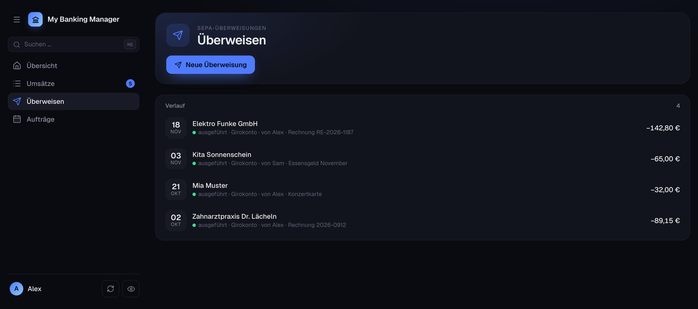
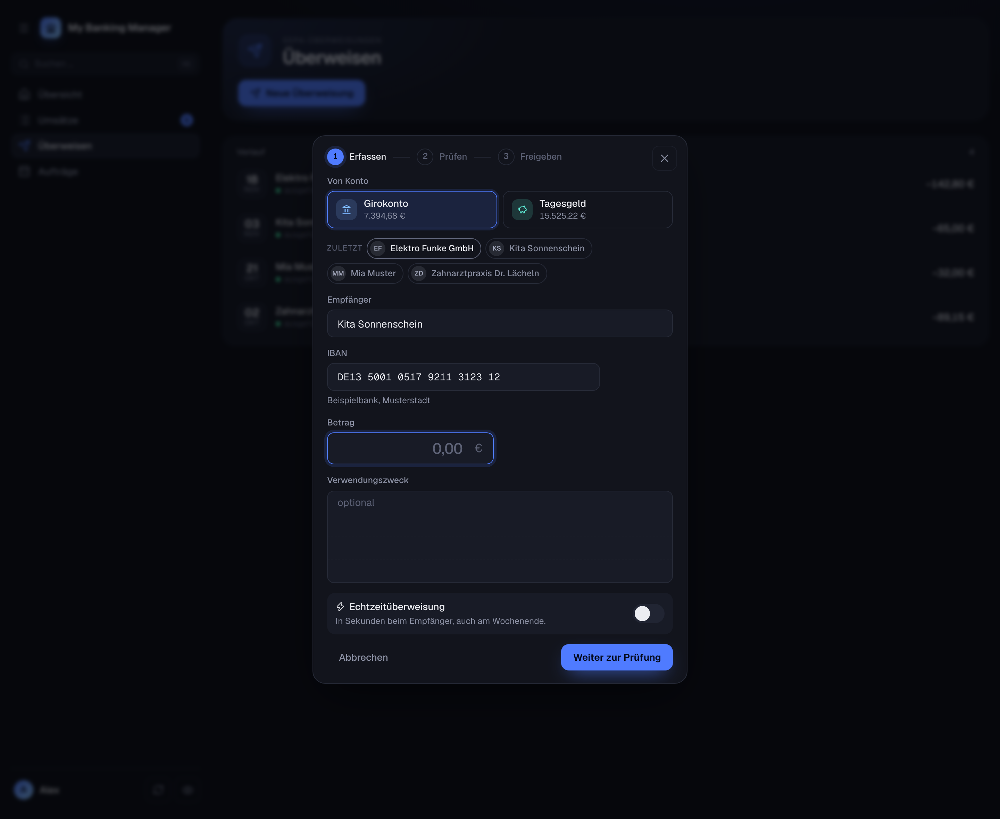

# Überweisen

Unter **Überweisen** stehen der Verlauf aller Überweisungen und der Knopf
**Neue Überweisung** (oder ++n++). Überweisen kann jeder Benutzer von den Konten, für die seine
eigene Bank-Anmeldung das erlaubt.

*Der Verlauf zeigt die Überweisungen aller Benutzer mit Status, Konto und wer sie gestartet hat.*

## Eine Überweisung in drei Schritten

*Erfassen: Konto, Empfänger, IBAN, Betrag und Zweck. Die zuletzt genutzten Empfänger stehen oben.*

1. **Erfassen:** Konto wählen, Empfänger und IBAN eingeben oder einen der letzten Empfänger
   antippen, Betrag und Verwendungszweck. MBM prüft die IBAN sofort und nennt die Bank dazu.
   **Echtzeitüberweisung** schaltest du ein, wenn das Geld in Sekunden ankommen soll und die Bank
   das anbietet.
2. **Prüfen:** Die Bank gleicht den Namen des Empfängers mit dem Konto ab
   (**Empfängerüberprüfung**). Passt er, geht es weiter. Weicht er ab, zeigt MBM den Namen, den
   die Bank kennt, und du entscheidest, ob du trotzdem überweist.
3. **Freigeben:** Du gibst die Überweisung in deiner Banking-App frei, etwa mit S-pushTAN.

Liegt die letzte Passworteingabe länger zurück (Standard 15 Minuten), fragt MBM vorher noch
einmal dein Passwort ab. Die eigentliche Sicherung bleibt die Freigabe in der Banking-App.

!!! warning "Nichts wird automatisch wiederholt"
    Ist unklar, ob die Bank eine Überweisung ausgeführt hat (etwa weil die Verbindung abriss),
    zeigt MBM **„Ausgang unbekannt“** und sendet sie nicht noch einmal. Prüfe dann die Umsätze:
    Sobald ein Abruf die Buchung bringt, wird daraus „ausgeführt“.

## Empfänger

Ausgeführte Empfänger merkt sich MBM. Dazu schlägt es Gegenseiten mit IBAN aus deinen Umsätzen
vor, etwa die Stadtwerke. In den Details eines Umsatzes startet „Überweisen an …“ eine
Überweisung an dieselbe Gegenseite.
