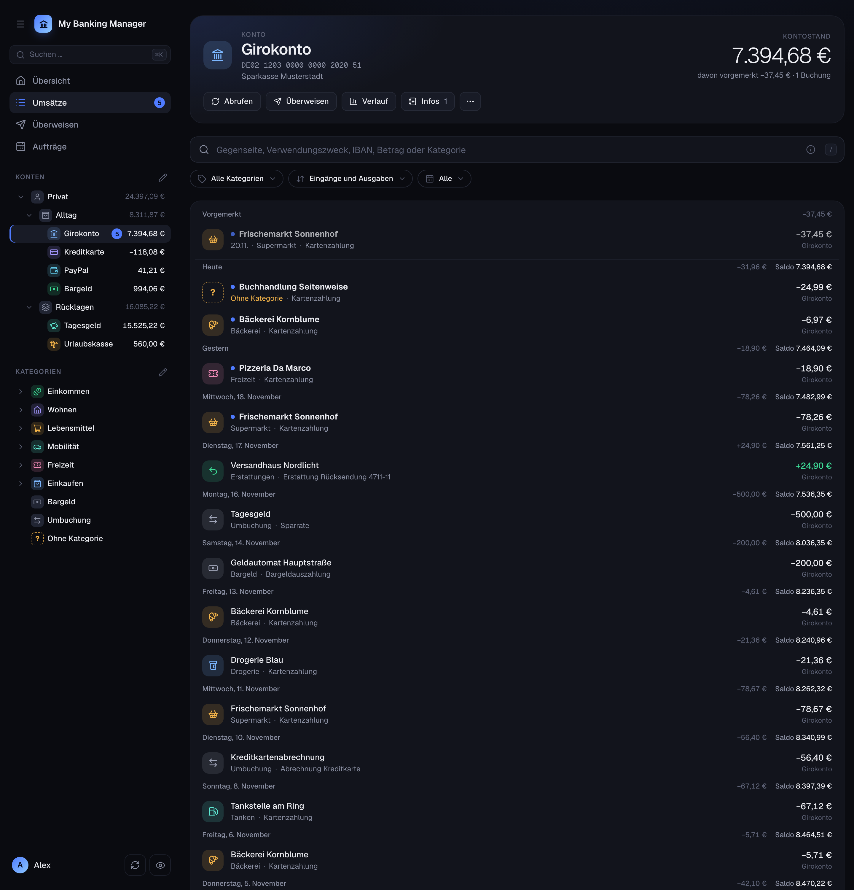
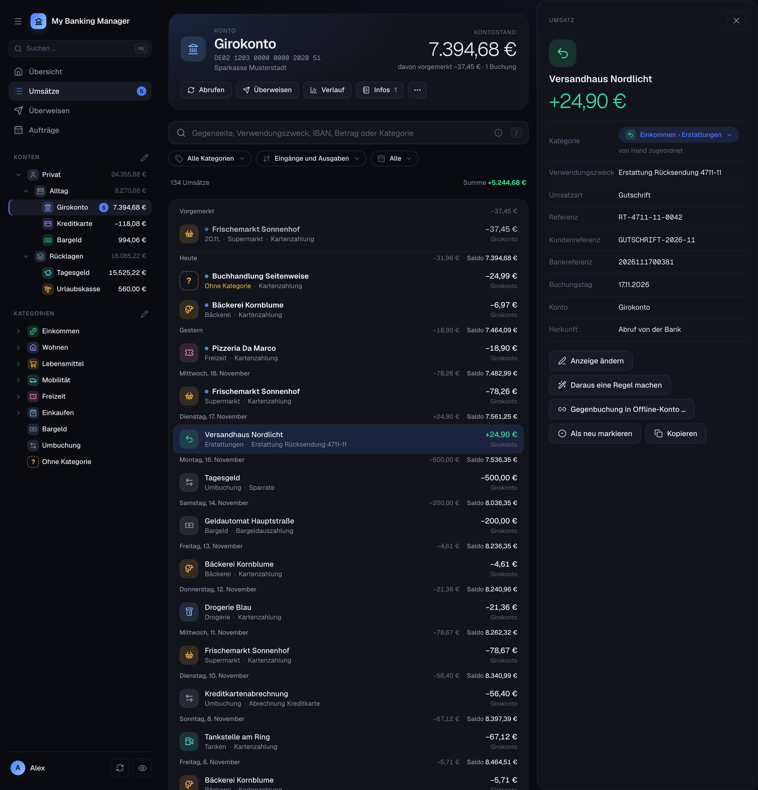
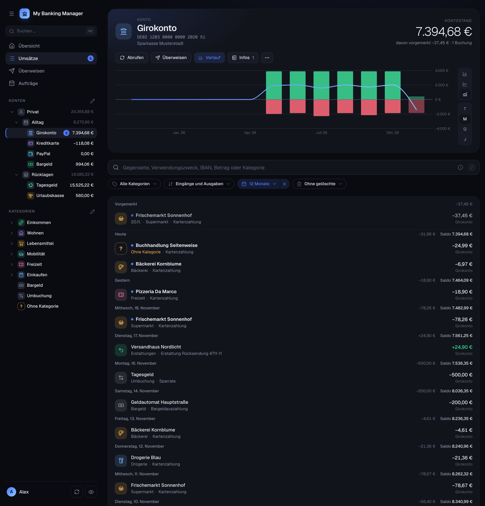
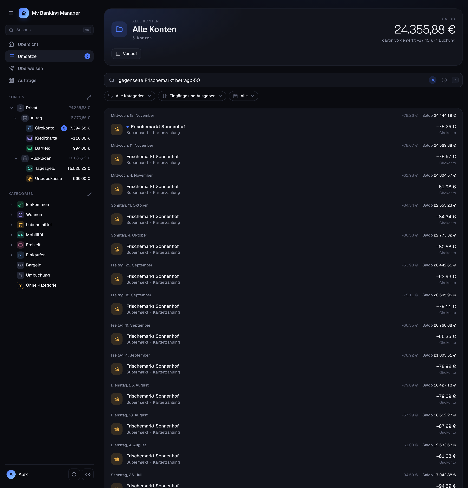
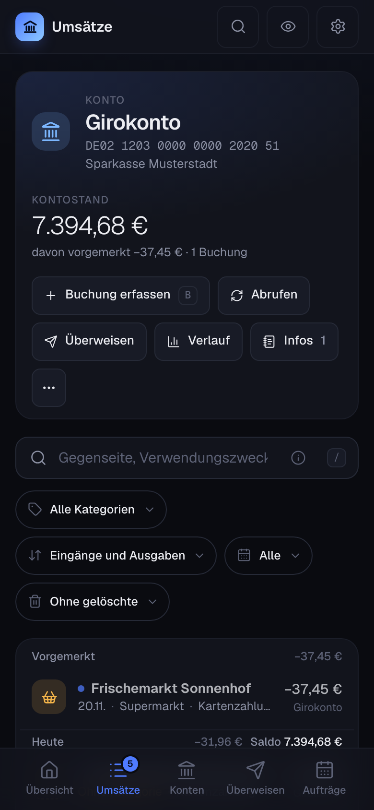

# Umsätze und Suche

Unter **Umsätze** stehen alle Buchungen. Links wählst du im **Kontenbaum** ein Konto oder eine
Gruppe, im **Kategorienbaum** eine Kategorie. Der Kopf zeigt dann Kontostand, IBAN und die
Aktionen dazu: Abrufen, Überweisen, Verlauf und Infos. Passt die IBAN oder Kontonummer nicht mehr in
eine Zeile, entfällt das Symbol, und Kontodaten und Kontostand stehen untereinander.

Scrollst du die Liste nach unten, bleibt vom Kopf oben eine schmale Leiste mit Symbol, Name und
Kontostand (bei einer Kategorie die Summe). Fährst du mit der Maus darüber, gleitet der ganze Kopf
mit seinen Aktionen herein. Verlässt du ihn, gleitet er wieder hinaus. Am Handy tippst du die Leiste
an, und Scrollen blendet den Kopf wieder aus.

*Die Umsätze eines Kontos. Vorgemerkte stehen oben, darunter die gebuchten nach Tagen mit Tagessumme und Saldo.*

Bei einer Kategorie zeigen die Tage nur die Tagessumme; ein Saldo gehört zu Konten, nicht zu
Kategorien.

## Neue Umsätze

Was ein Abruf von der Bank bringt, ist für alle Benutzer **neu**; was jemand importiert, für alle
anderen. Neue Umsätze haben einen Punkt, und ihre Anzahl steht an „Umsätze“ in der Seitenleiste
und an jedem Konto.

Ein Umsatz gilt als gelesen, sobald du seine Details öffnest. Von Hand geht das mit
**Als neu markieren** in den Details, mit „Gelesen“ / „Als neu“ für mehrere ausgewählte Umsätze
oder mit **Alle als gelesen markieren** im Menü eines Kontos.

## Details eines Umsatzes

Ein Klick auf einen Umsatz öffnet die Details daneben: Kategorie, Verwendungszweck, Umsatzart der Bank (etwa „Kartenzahlung“ oder
„Lastschrift“), Referenz, Kundenreferenz, Bankreferenz, Mandat, Gläubiger-ID, Daten, Konto, IBAN
oder Kontonummer und BLZ, BIC und Herkunft, soweit die Bank oder die
[importierte Datei](import.md#umsatzart-und-weitere-angaben) sie nennt.

Die **Referenz** ist die End-to-End-Referenz, die der Auftraggeber der Zahlung mitgibt. Die
**Kundenreferenz** nennt den Auftrag beim Auftraggeber, bei einer Sammelzahlung oft für alle Posten
gleich. Die **Bankreferenz** vergibt deine Bank selbst für die Buchung. Kunden- und Bankreferenz
liefert der Abruf von der Bank, beim [CSV-Import](import.md#referenzen) auch eine Datei, wenn du
sie im Format zuordnest. Umsätze, die schon vorher gespeichert waren, bekommen ihre
Kundenreferenz, wenn ein [Abruf](konten.md#abrufen) sie noch einmal holt, also ab zwei Wochen vor
dem letzten Abruf. Ältere Umsätze behalten sie leer.

Die Details bleiben offen, solange der Umsatz in der gezeigten Liste steht. Wechselst du das Konto
oder änderst Suche oder Filter und der Umsatz fällt heraus, schließen sie sich. Änderst du in einer
Kategorieansicht die Kategorie, bleiben sie offen, damit du noch eine Regel anlegen kannst.

Bei Kartenzahlungen meldet die Bank als Gegenseite oft nur den Abwickler, etwa eine Landesbank, und
den Händler als **abweichenden Empfänger**. MBM zeigt dann in Liste und Titel den Händler. In den
Details steht der Abwickler als „Kontoinhaber“, ihm gehört die IBAN. Die Suche mit `gegenseite:` und
Regeln finden den Umsatz unter beiden Namen.

Haben [Regeln](kategorien-regeln.md#regeln) oder du Gegenseite oder Zweck angepasst, zeigen Liste und
Details das Ergebnis. **Originaldaten** klappt die Werte der Bank auf. Dort zeigt „Verwenden“ für
dieses Feld wieder das Original und merkt sich das, „Wieder automatisch“ nimmt diese Entscheidung
zurück. Einen eigenen Text setzt du mit [Bearbeiten](#buchungen-erfassen-ändern-und-löschen).
Überweisungen nutzen immer Name, IBAN und Zweck der Bank. Die Suche findet angepasste und originale
Werte.

Ein Umsatz **ohne IBAN** ist normal und zählt wie jeder andere. Das betrifft etwa Entgelte, Zinsen,
Bargeld und manche Kartenzahlungen. Nennt die Bank stattdessen eine Kontonummer oder BLZ, stehen sie
in den Details. „Überweisen an …“ gibt es nur mit IBAN. Fasst die Bank mehrere Zahlungen in einer
**Sammelbuchung** zusammen, zeigt MBM die Gesamtsumme mit der Anzahl der Posten und ohne Gegenseite.
Die einzelnen Posten zeigt MBM nicht.

Gibt die Bank eine Lastschrift zurück, etwa mangels Deckung oder nach deinem Widerspruch, erscheint
eine **Rückbuchung** als eigener Umsatz. MBM verknüpft sie mit der ursprünglichen Buchung, wenn
Referenz, Mandat mit Gläubiger-ID oder die IBAN der Gegenseite passen, und gibt ihr deren Kategorie.
In den Details siehst du den Rückgabegrund und springst zur anderen Buchung. Beide bleiben in der
Liste und im Saldo, zählen aber nicht in „Eingänge und Ausgaben“ und in den Kategoriesummen. Die
Forderung ist damit meist nicht erledigt: Zieht der Gläubiger erneut ein, zählt das als neue Ausgabe.

*Die Details: Kategorie ändern, bearbeiten, löschen, als neu markieren, kopieren oder eine Gegenbuchung in einem Offline-Konto anlegen.*

**Mehrere Umsätze** wählst du mit ++x++, ++cmd++-Klick oder ++shift++-Klick aus. Dann weist ++c++
ihnen eine Kategorie zu. Mit ++j++ und ++k++ gehst du durch die Liste, ++enter++ öffnet einen
Umsatz.

## Buchungen erfassen, ändern und löschen

**Buchung erfassen** gibt es bei jedem Konto: im Menü des Kontos oder mit ++b++, bei einem
Offline-Konto auch im Kopf der Umsatzliste. Bei einem Bankkonto bleibt der Kontostand der Bank. Die Buchung verschiebt nur den
Saldoverlauf vor ihrem Datum, wie ein [CSV-Import](import.md). Liefert die Bank später dieselbe
Buchung (gleicher Tag, gleicher Betrag, gleiche Gegenseite), übernimmt sie deine. Deine Buchung
behält dann ihre Kategorie und kommt nicht doppelt. Eine vorgemerkte Buchung der Bank steht bis
dahin daneben.

**Bearbeiten** in den Details öffnet bei jedem Umsatz denselben Dialog. Eine Buchung, die du selbst
erfasst hast, änderst du darin ganz. Bei einem Umsatz von der Bank, aus einem Import oder einem, den
MBM für PayPal ergänzt hat, änderst du Betrag, Datum, Gegenseite und Verwendungszweck:

- **Betrag und Datum** zählen dann statt der Werte der Bank. Ein geänderter Umsatz trägt in der
  Liste „geändert“, die Details zeigen den ursprünglichen Wert („Laut Bank“). **Ursprüngliche
  Werte** im Dialog nimmt die Änderung zurück. Bei vorgemerkten Umsätzen geht das erst, wenn sie
  gebucht sind. Den Umsatz erkennt MBM beim nächsten Abruf und beim Import trotzdem, denn es
  vergleicht mit den Werten der Bank.
- **Gegenseite und Verwendungszweck** zeigt MBM statt der Texte der Bank, auch statt der Texte
  einer Regel. Leerst du ein Feld, zeigt es wieder den Text der Bank. Unter **Originaldaten** bleibt
  stehen, was die Bank geliefert hat.

Alles andere bleibt, wie die Bank es geliefert hat.

**Löschen** geht bei jedem Umsatz. Eine Buchung, die du selbst erfasst hast, ist danach weg. Alle
anderen blendet MBM nur aus: Sie verschwinden aus Liste und Auswertungen, kommen aber auch beim
nächsten Abruf oder Import nicht wieder. Das gilt auch für einen vorgemerkten Umsatz, sobald die
Bank ihn bucht. Löschst du eine PayPal-Zahlung, verschwindet die Abbuchung, die MBM dazu ergänzt
hat, mit ihr. Eine Gegenbuchung im Offline-Konto entfernt MBM. Über den Filter **Gelöschte** findest
du ausgeblendete Umsätze wieder, **Wiederherstellen** in ihren Details holt sie zurück. Das
[Protokoll](einstellungen.md#protokoll) hält Löschen und Wiederherstellen fest.

!!! note "Der Kontostand bleibt der der Bank"

    Bei einem Bankkonto ändern Erfassen, Ändern und Löschen den Kontostand nicht, denn den meldet die
    Bank. Die Differenz geht in den Anfangssaldo und verschiebt den Saldoverlauf vor dem Umsatz. Bei
    einem Offline-Konto ändert sich der Kontostand wie erwartet.

## Filter

Über der Liste stehen vier Filter: **Kategorien**, **Eingänge und Ausgaben**, **Zeitraum**
(dieser Monat, Vormonat, 30, 90 oder 365 Tage, alle) und **Gelöschte**. Der letzte zeigt nur
die gelöschten Umsätze und bleibt nicht für das Konto gespeichert.
Scrollst du die Liste, bleiben Suchfeld und Filter am oberen Rand stehen.

## Verlauf

**Verlauf** im Kopf blendet ein Diagramm für das gewählte Konto oder die Gruppe ein. Es deckt den
Zeitraum des Filters ab, bei einer Datumsbedingung in der Suche deren Tage. Rechts daneben wählst du
die Darstellung und gruppierst nach **T**ag, **M**onat, **Q**uartal oder **J**ahr:

- **Balken** und **Linie** zeigen den Kontostand: je Tag den Stand am Abend, je Monat, Quartal oder
  Jahr den Durchschnitt (Ø) der Tage.
- **Eingänge und Ausgaben** zeigt je Zeitraum die Summe der Eingänge als grünen Balken nach oben
  und die Summe der Ausgaben als roten Balken nach unten. Die Linie ist der Saldo des Zeitraums,
  also Eingänge minus Ausgaben. Gezählt wird wie bei der Karte „Eingänge und Ausgaben“ der
  Übersicht: ohne Umbuchungen und andere Kategorien, die [nicht in Auswertungen](kategorien-regeln.md) zählen, ohne
  zurückgegebene Lastschriften, eine aufgeteilte Buchung mit jedem Anteil.

Ein Zeitraum, den der Filter anschneidet (etwa der laufende Monat), ist blasser. Fährst du über
einen Wert, zeigt MBM die Beträge.

Klickst du auf einen Wert, scrollt die Umsatzliste zu seinem Zeitraum: Oben steht der jüngste Tag
darin mit Buchungen, darunter folgen die älteren Tage. Hat der Zeitraum keine Buchungen, etwa wegen
eines Filters, scrollt sie zum nächsten älteren Tag; liegt er vor der ersten Buchung, ans Ende der
Liste. Die Werte der Vorschau führen nirgendwohin.

*Eingänge und Ausgaben der letzten zwölf Monate; der laufende November ist blasser.*

## Suche

Das Suchfeld (++slash++) durchsucht Gegenseite, Verwendungszweck, IBAN, Betrag und Kategorie.
Das ⓘ daneben zeigt die ganze Syntax.

*`gegenseite:Frischemarkt betrag:>50`: alle Einkäufe dort über 50 €.*

| Eingabe | Findet |
|---|---|
| `rewe edeka` | beide Wörter (Leerzeichen = UND) |
| `rewe ODER edeka` | eines der Wörter |
| `NICHT paypal` · `-paypal` | ohne dieses Wort |
| `"rewe markt"` | genau diese Zeichenfolge |
| `Test*strasse` · `M??er` | `*` beliebig viele, `?` genau ein Zeichen |
| `gegenseite:rewe` · `zweck:miete` · `iban:DE89*` | nur in diesem Feld (Gegenseite: auch der abweichende Empfänger) |
| `umsatzart:lastschrift` · `art:karten*` | nur in der Umsatzart der Bank; ohne Feld sucht MBM nicht darin |
| `konto:giro` · `kategorie:Wohnen` | Konto oder Gruppe, Kategorie samt Unterkategorien |
| `ist:neu` | nur neue Umsätze |
| `>50` · `<=12,99` · `<-100` | Betrag; negativ heißt Ausgabe |
| `datum:3.2026` · `datum>=1.3.2026` | im März 2026, ab dem 1. März 2026 |
| `datum:-30t` · `-2w` · `-3m` · `-1j` | letzte 30 Tage, 2 Wochen, 3 Monate, 1 Jahr |
| `datum:vormonat` · `heute` · `woche` · `quartal` | relative Zeiträume, auch `vorwoche`, `vorjahr` … |

`UND`, `ODER` und `NICHT` (oder `AND`, `OR`, `NOT`) schreibst du in Großbuchstaben; Klammern
gruppieren. Die Felder gibt es auch mit englischen Namen: `counterparty:`, `purpose:`,
`type:`, `account:`, `category:` (`cat:`), `amount:`, `date:` und `is:new`. Ebenso die Zeiträume: `today`,
`yesterday`, `week`, `month`, `quarter`, `year`, mit `last…` davor (`lastmonth`), und `-30d`, `-1y`. Ein Datum in der Suche ersetzt den Zeitraum-Filter. ++esc++ leert das Feld.

## Am Handy

*Am Handy führt „Konten“ in der Tableiste zu Konten- und Kategorienbaum.*
