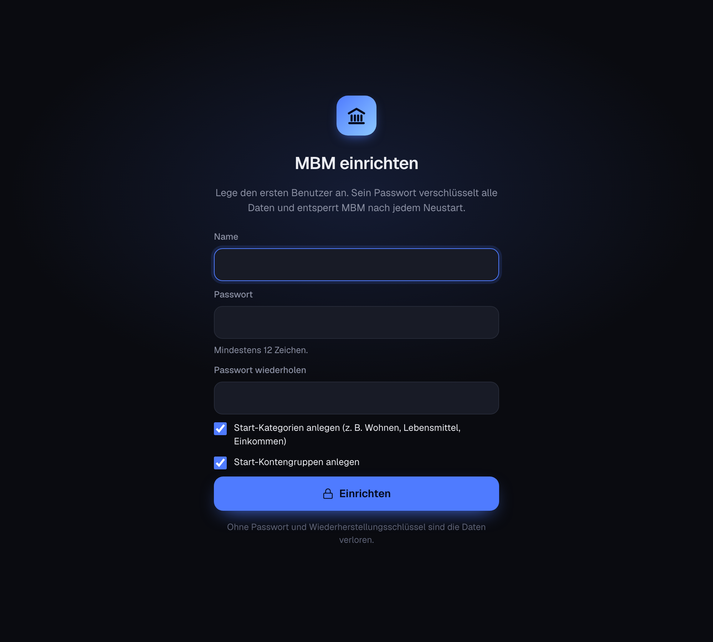
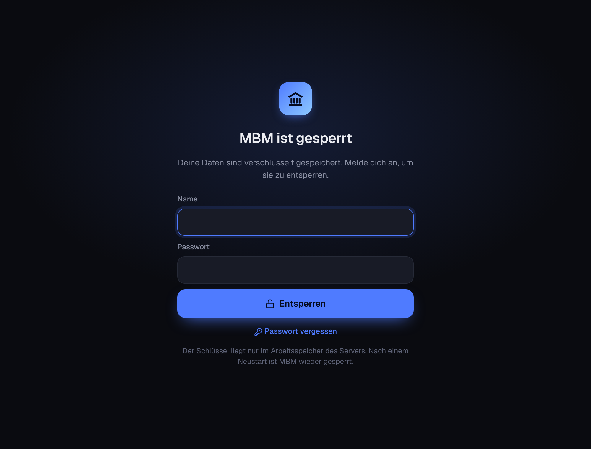

# Schnellstart

MBM läuft als Docker-Container. Du brauchst:

- einen Rechner im Heimnetz mit **Docker und Docker Compose** (amd64 oder arm64, etwa ein
  kleiner Server oder ein NAS),
- einen **Reverse Proxy mit HTTPS** davor (zum Beispiel Caddy, Traefik oder nginx). Er muss
  WebSockets unter `/api/events` durchreichen,
- eine Bank mit **FinTS-Zugang** (bei Sparkassen meist „HBCI/FinTS mit PIN/TAN“ im
  Online-Banking freischalten). Ohne Bank geht es auch: Offline-Konten brauchen keinen Zugang.

## 1. Starten

Lege in einem leeren Verzeichnis `compose.yaml` aus dem Repository ab und daneben eine Datei
`.env` (Vorlage: `.env.example`) mit dem offiziellen Image:

```bash
MBM_IMAGE_SERVER_FULL=ghcr.io/stefgo/mbm-server-full:latest
```

Dann:

```bash
docker compose pull && docker compose up -d
```

Der Container enthält Server, Web-Client und FinTS-Konnektor und hört auf Port `3040`. Die Daten
liegen im Volume `mbm-data`.

!!! tip "Hinter dem Reverse Proxy"
    Trag die Adresse oder das Netz deines Proxys als `MBM_TRUST_PROXY` ein, zum Beispiel
    `172.16.0.0/12` für Docker-Netze. Sonst erkennt MBM HTTPS nicht, und das Sitzungscookie bekommt
    kein `Secure`. Mehr unter [Konfiguration](konfiguration.md#hinter-dem-reverse-proxy).

??? note "Zwei Container statt einem"
    `compose.split.yaml` startet Server (`mbm-server`) und FinTS-Konnektor (`mbm-fints`) getrennt.
    Der Konnektor hat dann keinen Port und kein Datenvolume und spricht nur über einen Unix-Socket
    mit dem Server. **`mbm-fints` enthält keine FinTS-Produkt-ID:** Du brauchst eine eigene, siehe
    [Konfiguration](konfiguration.md#fints-produkt-id).

??? note "Selbst bauen"
    Ohne `MBM_IMAGE_SERVER_FULL` baut `docker compose up -d --build` das Image aus dem Quellcode.
    Auch dann brauchst du eine eigene FinTS-Produkt-ID.

## 2. Einrichten

Öffne MBM unter der Adresse deines Proxys (oder `http://<server>:3040`).



*Beim ersten Öffnen legst du den ersten Benutzer an.*

1. **Name und Passwort** des ersten Benutzers, mindestens 12 Zeichen. Das Passwort verschlüsselt
   die Datenbank. Start-Kategorien und Start-Kontengruppen kannst du hier abwählen.
2. Den **Wiederherstellungsschlüssel** sicher aufbewahren, getrennt vom Backup. Ohne ihn und ohne
   Passwort sind die Daten verloren; auch MBM kann sie dann nicht mehr öffnen.
3. Die **Authenticator-App** einrichten (TOTP, etwa mit einer Passwort-App oder einer
   Authenticator-App auf dem Handy). Ab jetzt fragt MBM bei jeder neuen Anmeldung nach dem Code.
4. Unter **Einstellungen → Konto hinzufügen** einen Bankzugang (FinTS) oder ein Offline-Konto
   anlegen. Wie das geht, steht unter [Konten](guide/konten.md).

## 3. Nach einem Neustart

Nach jedem Neustart von Container oder Rechner ist MBM **gesperrt**. Der Schlüssel der Datenbank
liegt nur im Arbeitsspeicher; das erste Anmelden mit einem Passwort entsperrt MBM wieder.



*Gesperrt: Name und Passwort entsperren MBM.*

## Wie geht es weiter?

- [Konfiguration](konfiguration.md): Proxy, Sperrzeiten, Produkt-ID, Startwerte
- [Updates und Backup](updates.md): was du sichern musst und wie ein Update geht
- [Benutzung](guide/uebersicht.md): die Seiten von MBM im Einzelnen
